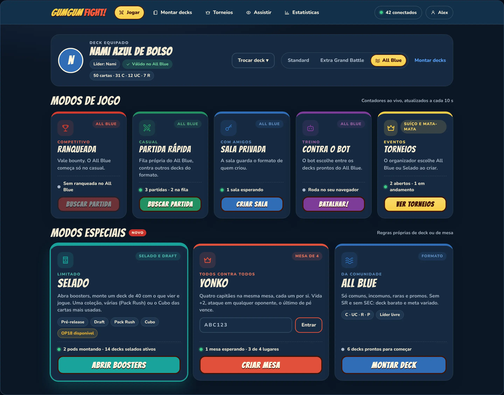
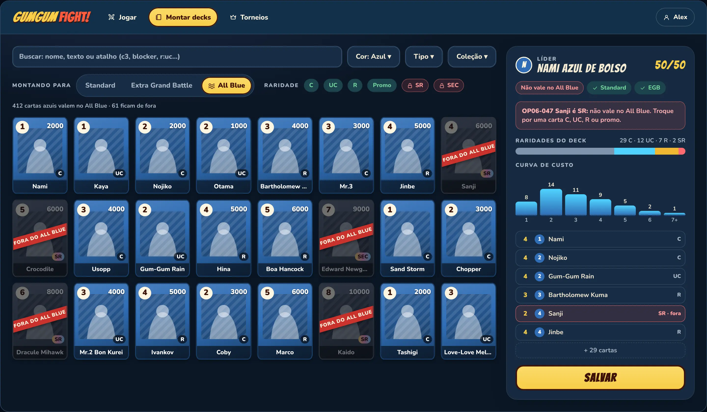
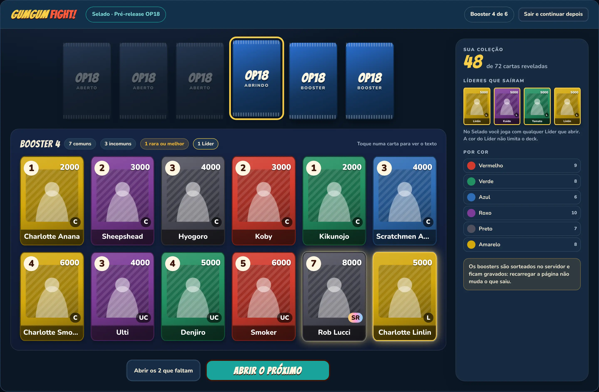
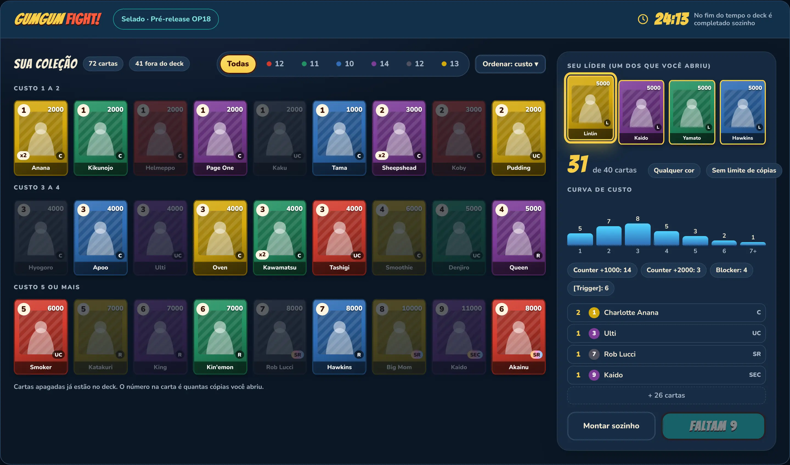
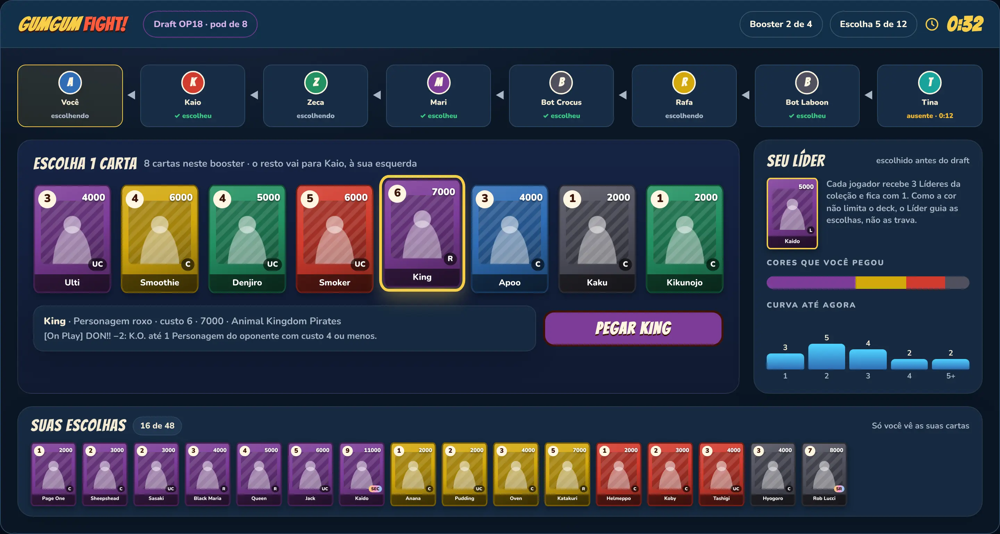
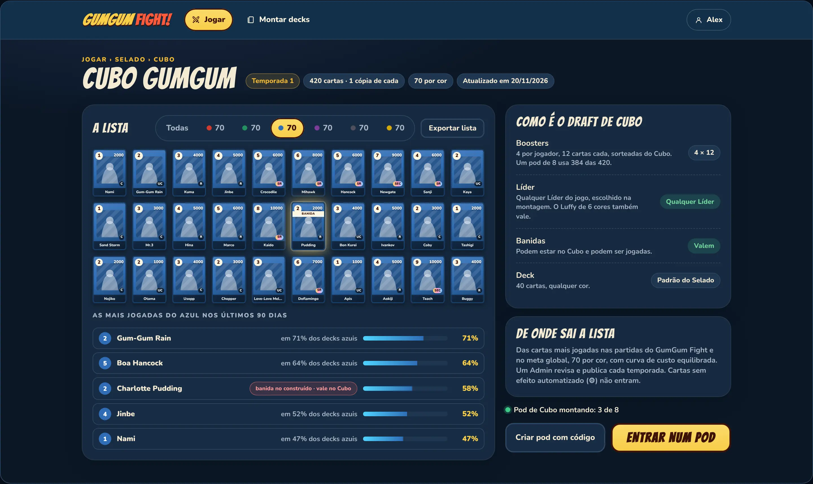
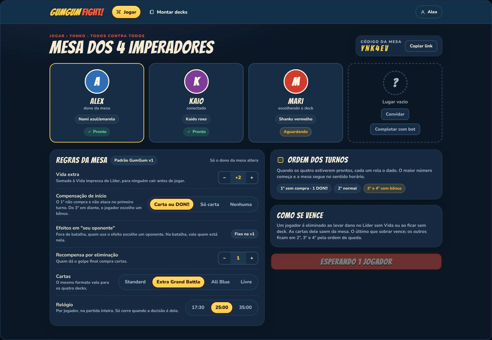

# Plano: novos modos de jogo (All Blue, Selado, Pack Rush, Cubo e Yonko)

> Status (22/11/2026): **All Blue, Pré-release (Selado de uma coleção), Pack Rush (selado e draft), Draft e Draft Cubo
> implementados**; o README (seções "All Blue", "Selado", "Pack Rush", "Draft" e "Draft Cubo") descreve o que existe.
> **Yonko: fases 1, 2 e 3 feitas** (o motor com até 4 jogadores pelas regras do manual do formato, a mesa online
> com código para até 4 pessoas e bots nos lugares vagos, a mesa local contra bots, e o construtor de decks de 60;
> ver a seção 4, [`regras-yonko.md`](regras-yonko.md) e a seção "Yonko" do README). Falta a fase 4 (espectador e
> replay) e o bot com busca.
> As telas estão em [`docs/mockups/modos-de-jogo/`](mockups/modos-de-jogo/index.html) (abra o `index.html` no navegador;
> as imagens `.webp` da pasta são as mesmas telas). As cartas das telas são ilustrativas e os números são de exemplo.

## 1. Resumo

| Modo | O que é | Tamanho | Mexe no motor? | Maior risco |
|---|---|---|---|---|
| **All Blue** ✅ | Formato da comunidade no estilo Pauper: só cartas C, UC, R e promos (sem SR e sem SEC). Partida 1x1 normal. | Pequeno | Não | Qualidade do campo `rarity` das cartas |
| **Selado: Pré-release** ✅ | O jogador abre 6 boosters de uma coleção e monta um deck de 40 com o que saiu. | Médio | Pouco (tamanho do deck) | Fidelidade do booster e cartas ⚙ na coleção |
| **Selado: Draft** ✅ | Pod de 8 (bots nos lugares vazios): cada um abre um booster, pega 1 carta e passa o resto. Deck de 40. | Médio para grande (em cima do Pré-release) | Não | Sala em tempo real nova e bots que escolhem |
| **Pack Rush** ✅ (selado e draft) | Selado ou Draft com boosters de **coleções variadas**; quem abre o pod escolhe quais entram. | Pequeno (em cima do Selado e do Draft) | Não | Booster configurado e cobertura de efeitos em **todas** as coleções, não só na mais nova |
| **Draft Cubo** ✅ | Draft num conjunto fixo com as **cartas mais usadas** de One Piece, de todas as coleções. | Pequeno para médio (em cima do Draft) | Não | Manter a lista boa: curadoria a cada temporada |
| **Yonko** 🚧 (jogável online; falta espectador e replay) | Mesa de 4, todos contra todos, deck de 60 sem repetição: o formato da comunidade "Four Emperors". | Muito grande | **Sim**, bastante | O motor, a mesa e o bot foram feitos para 2 jogadores |

Em esforço relativo, com o All Blue valendo 1: Pré-release ≈ 3, Draft ≈ +2, Pack Rush ≈ +1, Cubo ≈ +1,5 e Yonko ≈ 8
ou mais. O Yonko é o único que muda o motor de regras; os outros são regras de deck e telas novas em volta da partida
que já existe.

**Ordem sugerida:** All Blue → Pré-release → Pack Rush selado → Draft (já com Pack Rush) → Cubo → Selado nos torneios →
Yonko. Cada passo é entregável sozinho, e dá para parar depois de qualquer um.

De onde vêm as regras: All Blue, Pack Rush e Cubo são formatos de fã, definidos por você nesta conversa. O Yonko
segue o manual do formato da comunidade ("Four Emperors Play Sheet", resumido em [`regras-yonko.md`](regras-yonko.md)).
O Selado segue o que a Bandai publica; o Draft não tem regra oficial que eu tenha encontrado, então a proposta é nossa.

## 2. All Blue

### Regras

- Vale toda carta lançada com raridade **C, UC, R ou promo (P/PR)**. **SR e SEC ficam de fora.**
- O Líder (raridade L) é livre.
- **Nenhuma carta banida.** As banidas, os pares proibidos e a rotação da Bandai não se aplicam. A lista de banidas do
  All Blue é própria e começa vazia; uma carta entra nela se as reclamações mostrarem que ela desbalanceia o formato.
- O resto é o jogo normal: 1 Líder, 50 cartas, até 4 cópias, cor do Líder.
- A raridade é a do número da carta. Arte alternativa (Parallel, SP, Manga) não muda nada: uma SR com arte promocional
  continua SR.

### Como ficou

- **Formato novo (`allblue`) em `packages/engine/src/formats.ts`:** `cardLegality` e `formatIssues` passaram a receber
  o catálogo, porque a regra depende da raridade. Carta sem raridade conhecida fica fora (`rules.rarityUnknown`), para
  uma SR não passar por falta de dado. `ALL_BLUE_BANNED` é a lista própria, vazia.
- **Onde se joga:** fila casual própria, sala privada, treino contra o bot e torneios. Sem ranqueada (`hasRanked`) e
  fora das estatísticas do construído (`countsInStats`).
- **Decks prontos:** seis em `data/decks/allblue/` (os primeiros starters sem as SR), num grupo à parte para não
  entrarem no sorteio do oponente nem na Sala do Tempo dos outros formatos.
- **Interface:** terceiro formato na tela inicial, selo "All Blue" nos decks que valem, "Montar para o All Blue" no
  construtor (filtra o catálogo e marca o que não vale) e o atalho `allblue` na busca. Textos nos seis idiomas.
- **Auditoria:** `npm run cards:check-rarity -w @gumgum/server` lista as cartas sem raridade conhecida.

### Diferenças para as telas da proposta

- O construtor não tem o seletor "Montando para" com os três formatos nem a barra de raridades do deck: ficou uma
  opção só, "Montar para o All Blue", que esconde do catálogo o que não vale (em vez de mostrar apagado).
- A tela inicial não tem o cartão explicativo do All Blue na fileira de modos especiais (essa fileira entra com o
  Selado e o Yonko). Com o formato escolhido, a faixa do deck mostra "Só C, UC, R e promo".

### Em aberto

1. **Ranqueada:** ficou só casual, como recomendado. Abrir uma ranqueada do All Blue é ligar o formato em `hasRanked`.
2. **Estatísticas:** as partidas são gravadas, mas fora das telas de estatísticas. Um meta próprio do All Blue pede uma
   aba separada, para não misturar com Standard e EGB.

## 3. Modos limitados: Selado, Draft, Pack Rush e Cubo

### O que já existe (Pré-release, Pack Rush, Draft e Draft Cubo)

O **Draft Cubo** entrou como a terceira opção da tela do Selado ("Uma coleção", "Pack Rush", "Cubo"): a lista da
Temporada 1 (420 cartas, 70 por cor, uma cópia de cada), a página da lista com o uso de cada carta e o pod que drafta
dela, com qualquer Líder na montagem. Diferenças para a proposta e para a tela 11:

- **A fonte do uso mudou.** O plano dizia "o meta global do TCG Matchmaking, que o app já baixa", mas esse meta só tem
  Líderes, não as cartas dos decks. A lista saiu das decklists de torneios online do Limitless TCG (API pública):
  30.420 decks em 87 torneios, de 2023 a 2026. Não entram as partidas do GumGum Fight.
- A porcentagem de cada carta é o uso no melhor ano dela (média dos 4 melhores trimestres), e não "nos últimos 90
  dias" nem "dos decks da cor".
- Não há "Exportar lista", o aviso de carta banida nem "Entrar num pod" público; o pod é pelo código, como no Draft.
- A revisão por um Admin é editar o arquivo `data/cubes/t1.json` (ou gerar outro com `npm run cube:build`); a tela de
  Admin ficou para depois.

O **Draft** entrou com pod de 8 e bots nos lugares vazios (decisão 3): código de 6 letras para chamar os amigos, 4
boosters de 12 cartas por jogador, prazo por escolha (46 s caindo até 13 s) com escolha automática do servidor, e o
Pack Rush draft pelas coleções marcadas. As escolhas viram um deck selado, e a sala privada desse deck só aceita
decks do mesmo pod. Diferenças para as telas 5 a 7: não há link de convite (é o código), a tela consulta o servidor a
cada segundo em vez de ficar numa conexão aberta, e depois do draft não há chave entre os 8: cada um joga com quem
quiser do pod, ou contra um dos bots que draftaram. Ficou para depois: fila pública de pods, rodadas ou chave dentro
do pod e torneio de Draft.

O Pack Rush selado entrou na mesma tela: escolher de 2 a 12 coleções, 6 boosters sorteados entre elas, qualquer Líder
do jogo (com a folha de escolha da tela 12) e sala privada entre decks das mesmas coleções. Diferenças para a tela 10:
não há "pod" com vários jogadores nem o botão de sortear coleções; cada jogador abre os próprios boosters e a sala
privada confere que os dois escolheram as mesmas coleções. O pod de verdade existe no Draft.

Abrir 6 boosters de uma coleção, montar o deck de 40 (com "Montar sozinho"), o Líder de 6 cores e jogar contra o bot
ou em sala privada, com o servidor sorteando e conferindo tudo. Ficou para os próximos passos:

- **Fila do Selado** e **torneio de Selado** (hoje só bot e sala privada).
- **Abertura de coleção de spoiler por um Admin:** hoje a coleção entra sozinha quando está completa no banco e com
  70% dos efeitos automatizados.
- **Modelo de booster por coleção:** feito por linha de produto (primeiras coleções, principal de hoje e Extra
  Booster), com as taxas de aberturas de caixas registradas pela comunidade; veja "Os boosters" no README. Ficou no
  código (`BOOSTER_MODELS`), e não em `data/boosters/`. A arte do produto e a animação de abrir também entraram.
- **Relógio de montagem** (30 minutos): só faz sentido em evento; sozinho, o jogador monta no próprio tempo.
- A carta do Luffy de 6 cores não tem número na lista oficial (o P-047 é outro Luffy), então entrou com id próprio
  (`SEALED-001`).

### Os cinco modos são duas escolhas

Todos saem da mesma tela: primeiro **de onde vêm as cartas**, depois **como o jogador monta**.

| De onde vêm as cartas | Selado (abre sozinho) | Draft (pod, pega 1 e passa) | Líder |
|---|---|---|---|
| **Uma coleção** | Pré-release | Draft | Os que o jogador abrir ou pegar, ou o **Luffy de 6 cores** |
| **Pack Rush** (várias coleções, escolhidas por quem abre o pod) | Pack Rush selado | Pack Rush draft | **Qualquer Líder do jogo** |
| **Cubo** (as cartas mais usadas) | não existe | Draft Cubo | **Qualquer Líder do jogo** |

Por baixo é um motor só: uma "fonte de boosters" (coleção, lista de coleções ou cubo) e duas formas de distribuir as
cartas. Por isso Pack Rush e Cubo custam pouco depois que Selado e Draft existem.

### Regras comuns a todos

- Deck de **40 cartas** + 1 Líder + 10 DON!!, só com as cartas abertas ou draftadas.
- **A cor do Líder não limita o deck** e não há limite de cópias.
- **Banidas e pares proibidos valem.** Nenhum desses modos é formato oficial de torneio, então a lista de restrições da
  Bandai (`BANNED_CARDS`, `BANNED_PAIRS`) e a rotação do Standard não se aplicam. Uma carta banida pode sair num
  booster, estar no Cubo e ser jogada; um Líder banido pode ser escolhido no Pack Rush e no Cubo.
- As partidas ficam fora das estatísticas e do meta do construído.

### Líder

- **Uma coleção (Pré-release e Draft):** o jogador usa um Líder que abriu ou pegou no draft, ou o **Luffy de 6 cores**,
  que todo jogador tem sempre. É a regra dos eventos Sealed Battle da Bandai: o Líder de 6 cores existe para ninguém
  ficar sem Líder, seja qual for a cor que sair.
- **Mais de uma coleção (Pack Rush e Cubo):** vale **qualquer Líder do jogo**, escolhido na montagem do deck, além do
  Luffy de 6 cores. Como são mais de cem Líderes, o seletor sugere primeiro os das cores e dos tipos que o jogador mais
  pegou (tela 12).
- Com o Luffy garantido, o booster simulado **não precisa mais trazer um Líder por pacote**: pode seguir a
  distribuição do produto real.
- **A carta:** Vida 5, 5000, Strike, Straw Hat Crew, "treated as a card with all card names, types, and attributes".
  Não tem número impresso; no app é `SEALED-001`.

### Selado e Draft com uma coleção

| Ponto | Proposta | Observação |
|---|---|---|
| Boosters no Pré-release | 6 por jogador (72 cartas) | É o número dos eventos Sealed Battle oficiais. |
| Draft | Pod de 4 a 8, **4 boosters** por jogador, 12 cartas cada (48 escolhas) | Sem regra oficial. Com 3 boosters não dá para chegar a 40. |
| Tempo | 30 min para montar; no Draft, 45 s por escolha, caindo conforme o booster esvazia | Sem escolha no tempo, o servidor escolhe. |

**Modelo do booster:** um por linha de produto (primeiras coleções, principal de hoje e Extra Booster), com vagas
fixas, uma vaga de destaque (rara, SR ou SEC) e o Líder no lugar de uma comum. A Bandai não publica as taxas; as usadas
vêm de aberturas de caixas registradas pela comunidade ("Os boosters", no README).

O **pré-release de verdade** sai de graça daqui: a coleção de spoiler que o app já acompanha (`data/spoilers`, hoje
EB05 e OP18) vira opção quando estiver completa o bastante. Quem decide que ela abriu é um Admin.

### Pack Rush

- **Quem abre o pod escolhe as coleções** que entram (tela 10).
- **Cada jogador recebe boosters sorteados entre as coleções escolhidas** (6 no selado, 4 no draft): dois jogadores do
  mesmo pod podem abrir coleções diferentes. No draft, o booster passa de mão em mão normalmente; só muda que os
  boosters de uma mesma rodada podem ser de coleções diferentes.
- Pack Rush é sempre um pod ou uma sala criada por alguém. Para jogar sozinho contra o bot, o jogador abre um pod só
  dele.
- Só entram na lista as coleções com booster configurado e cobertura de efeitos acima do piso. É aqui que mora o custo
  do Pack Rush: o Selado de uma coleção só exige cuidar da coleção nova; o Pack Rush exige cuidar de todas.
- Coleções de spoiler podem entrar se quem abre o pod marcar; os Líderes de spoiler só valem nesse caso.

### Draft Cubo

- O **Cubo** é uma lista fixa em `data/cubes/<id>.json`: 420 cartas, **uma cópia de cada**, 70 por cor, com curva de
  custo equilibrada. Sem Líderes (o Líder é livre).
- **De onde sai a lista:** das **estatísticas de uso globais**, e não das partidas do GumGum Fight: as decklists de
  torneios online do Limitless TCG (o meta do TCG Matchmaking que o app baixa só tem Líderes). Um script
  (`npm run cube:build`) gera a lista (mais usadas por cor), publicada como "temporada". Cartas ⚙ (efeito não automatizado) não entram. Uma lista montada à mão por você fica para depois; o
  arquivo da temporada já é editável.
- **Os boosters** são 12 cartas sorteadas do Cubo, sem vaga de raridade e sem repetir carta no pod. Um pod de 8 usa 384
  das 420.
- A página do Cubo (tela 11) mostra a lista inteira e o uso de cada carta antes de o jogador entrar.

### Como o jogador joga com o deck

Depois de montar, o deck selado é um deck de verdade, mas preso àquelas cartas:

- **Contra o bot** e **sala privada**, na hora.
- **Fila do Selado:** pareia só decks da mesma fonte (mesma coleção; Pack Rush e Cubo jogam dentro do pod).
- **Pod:** os jogadores do pod se enfrentam (pod de 4: semifinal e final; pod de 8: 3 rodadas de suíço),
  reaproveitando o módulo de torneios.
- **Evento** (fase seguinte): o organizador cria um torneio com "deck: Selado OP18", "Pack Rush" ou "Cubo"; no início,
  cada inscrito recebe os boosters ou entra no draft, há a fase de montagem com relógio e o deck congela, como já
  congela a lista na inscrição hoje.

### O que muda no código

- **Fonte de boosters (`packages/engine/src/sealed.ts`, novo):** função pura com seed. Três fontes com a mesma
  interface: `set` (modelo do booster da coleção), `mix` (uma coleção por posição) e `cube` (sorteio sem reposição).
- **Servidor é a autoridade (`apps/server/src/sealed/`, novo):** as cartas de cada jogador são sorteadas e gravadas no
  servidor (`sealed_pools`: dono, fonte, seed, cartas, tipo; `sealed_decks`: a lista de 40). O cliente só revela. Antes
  de cada partida o servidor confere que o deck sai daquelas cartas.
- **Regras de construção (`deck.ts`, `formats.ts`):** `validateDeck` ganha um perfil de regras (`constructed` ou
  `limited`): tamanho 40, sem cor, sem limite de cópias, cartas ⊆ as do jogador, e a regra do Líder (`pool` = Líder
  aberto ou Luffy de 6 cores; `any` = qualquer Líder). No perfil `limited`, `formatIssues` não roda: nem banidas, nem
  pares, nem rotação.
- **Motor (`engine.ts`):** `createGame` recusa deck diferente de 50 (`DECK_SIZE`). Passa a aceitar o tamanho pela
  configuração da partida. É a única mudança no motor; replays e partidas antigas não mudam.
- **Construtor:** um modo "coleção" do `DeckBuilder` (catálogo = suas cartas, com contador de cópias) em vez de uma
  tela nova, mais o seletor de Líder. "Montar sozinho" usa uma heurística simples (curva, Counters, cor dominante).
- **Draft (`apps/server/src/draft/`, novo):** sala em tempo real pelo mesmo transporte das partidas (SSE + POST):
  lugares, boosters em rodízio, relógio por escolha, reconexão, e retomada depois de deploy (gravar o estado, como
  `live_matches`). Bots de draft escolhem por uma nota simples (raridade, custo, poder, palavra-chave; no Cubo, o uso
  da carta).
- **Cubo:** o script que gera a proposta a partir das estatísticas, o arquivo da temporada, a página da lista e uma
  tela de Admin para revisar e publicar.
- **Idiomas:** todo texto novo nos seis idiomas da interface.

### Riscos

- **Cartas ⚙ (efeito não automatizado):** no construído o jogador evita; no Selado elas saem no booster. Proposta:
  a coleção só entra acima de um piso de cobertura, e a carta ⚙ aparece marcada na abertura. No Cubo elas ficam de fora.
- **Qualquer Líder com qualquer cor:** sem a trava de cor, alguns Líderes ficam muito acima dos outros no Pack Rush e
  no Cubo. É esperado num modo por diversão; se virar problema, dá para ter uma lista de Líderes fora desses modos.
- **Coleção de spoiler incompleta:** sem todas as cartas e raridades não dá para montar booster. Por isso a abertura é
  uma decisão de Admin, não automática.
- **Bot com deck de 40 sem perfil:** o bot genérico joga qualquer lista, mas pior que com os decks do meta. Aceitável
  para treino.

### Decisões

Já decididas por você: Líder (Luffy de 6 cores nos modos de uma coleção; qualquer Líder nos de várias), banidas (valem
em todos os modos limitados), Pack Rush (boosters sorteados por jogador entre as coleções escolhidas) e Cubo (uma cópia
de cada, lista pelas estatísticas globais) e Draft (pod de 8 com bots completando os lugares vazios).

4. **Vida do deck selado:** jogar à vontade enquanto a fonte estiver no ar (o que as telas mostram), ou formato de
   "corrida" que termina com X derrotas?

## 4. Yonko (mesa de 4)

### Regras

As regras são as do manual do formato, "Four Emperors Play Sheet". O resumo, regra a regra, com o que o motor faz
em cada uma e o que é interpretação nossa, está em [`regras-yonko.md`](regras-yonko.md). Em poucas linhas:

- **4 jogadores**, deck de **60 cartas, uma cópia de cada** (a carta é o número dela), só da cor do Líder.
- **Ordem:** sorteio de quem começa; a mesa segue no sentido horário.
- **Largada:** antes das mãos, cada um escolhe o próprio primeiro turno: **1 DON!! e comprar 1 carta**, ou **2 DON!!
  sem comprar**. Depois, mão inicial, mulligan normal e a Vida.
- **Vida:** a impressa no Líder **+2**.
- **Ataque:** o alvo pode ser de qualquer oponente. O valor de Counter e o [Blocker] são só de quem foi atacado; quem
  está de fora pode jogar Evento [Counter] e reage a ataques e bloqueios dos oponentes.
- **Efeitos em "seu oponente":** alvo em campo é qualquer alvo legal de qualquer oponente; o que mexe na mão ou na
  Vida vale para cada oponente; efeitos contínuos valem para todos; condição precisa de um oponente só.
- **Duração:** "até o fim do turno do seu oponente" vira "até o começo do seu turno".
- **Fim:** "you win the game" encerra a partida; fora isso, vence o último de pé.

O manual não fala de eliminação, relógio nem recompensa. No motor, quem leva dano no Líder sem Vida, fica sem deck,
desiste ou estoura o tempo sai da mesa (as cartas dele saem do jogo) e a mesa segue. O relógio é assunto da fase 2:
a proposta é 25 minutos por jogador (hoje são 17:30 no 1x1), correndo só nas decisões dele.

> A primeira versão da fase 1 seguia três regras propostas aqui antes de o manual chegar (quem usa o efeito
> escolhia um oponente; em batalha só valia o outro jogador da batalha; bônus de +1 carta ou +1 DON!! para o 3º e o
> 4º; deck de 50; comprar 1 por eliminação). O manual manda diferente e o motor foi ajustado: a tabela do "antes e
> agora" está no fim de `regras-yonko.md`.

### O que muda no código

- **Motor (`packages/engine`):** feito na fase 1 (ver abaixo).
- **Servidor (`online/room.ts`, `lobby.ts`):** a sala assume 2 lugares (`seats.length !== 2`). Passa a N lugares, com
  relógio, reconexão, abandono que elimina em vez de encerrar, e a gravação para retomar depois de deploy.
- **Interface:** uma mesa nova (`YonkoBoard`), não uma adaptação de `Board`/`WideBoard`: três oponentes compactos em
  cima, a sua mesa embaixo, alvos acesos nas três mesas ao atacar. No celular, os oponentes viram abas. `GameScreen.tsx`
  (3.800 linhas) concentra muita lógica de dois lados e é onde mora a maior parte do trabalho de interface.
- **Replay e espectador:** o formato do replay e o modo espectador passam a aceitar N jogadores.
- **Bot:** o planejador (`bot/planner.ts`, `evaluate.ts`) avalia uma posição contra um oponente. Para a v1, um bot
  simples que escolhe o alvo por heurística (quem está mais perto de cair, quem ameaça mais) serve para completar mesa;
  não vai jogar bem.
- **Fora das estatísticas e do bounty.**

### Fases do Yonko, com ponto de parada

1. ✅ **Motor com N jogadores, sem tela:** regras, eliminação, escolha de oponente, e uma simulação de milhares de
   partidas de 4 bots simples para achar cartas que quebram. **Ponto de decisão:** se a lista de cartas problemáticas
   for longa demais, paramos aqui sem ter gasto com tela. (Resultado abaixo: a lista veio vazia.)
2. ✅ **Sala e servidor** para 4 humanos (sala privada com código), com bots nos lugares vagos (ver "Fase 2: como
   ficou").
3. ✅ **Mesa** no computador e no celular (feita antes da fase 2, como mesa local contra bots; ver "Fase 3: como
   ficou").
4. **Bot** para completar mesa (o bot simples já completa a mesa local), espectador e replay.

### Fase 1: como ficou

Tudo no motor (`packages/engine`); servidor e interface não mudaram, e nada disso aparece para o jogador ainda.
Cada regra do manual tem a linha correspondente em [`regras-yonko.md`](regras-yonko.md).

- **Mesa de 2 a 4 lugares.** `createGame` aceita até `MAX_PLAYERS` (4) jogadores e as regras da mesa em
  `GameConfig.table` (`TableRules`: `extraLife`, `curveChoice`, `eliminationDraw`). `YONKO_TABLE` traz as do manual
  (+2 de Vida e a escolha da largada). Com dois jogadores `table` é ignorado.
- **Deck.** `validateYonkoDeck`: 60 cartas, uma cópia de cada número, cor do Líder.
- **Preparação e turnos.** Sem `firstPlayer`, o sorteio escolhe um lugar e a ordem segue os lugares. Antes das mãos,
  cada um escolhe a largada (uma escolha `option` com `curve`); depois as mãos, os mulligans na ordem e a Vida.
  Ninguém ataca no próprio primeiro turno (`turnsTaken`), e a ordem pula quem saiu.
- **Ataque e batalha.** O alvo pode ser o Líder ou um Personagem de qualquer oponente. Só o defensor bloqueia e usa
  o valor de Counter. Na etapa de Counter, os outros oponentes do atacante podem usar Eventos [Counter] antes do
  defensor (`counter` com `bystander`), e [On Your Opponent's Attack] dispara para todos os oponentes do atacante.
- **"Seu oponente".** Alvo em campo: as cartas de todos os oponentes. Mão, Vida, DON!! e deck "do oponente": o
  passo roda uma vez contra cada oponente (`eachOpponent`), com a condição dele conferida contra cada um. Condição
  num efeito que não atinge o oponente: basta um (`anyOpponent`). Auras e [Opponent's Turn]: todos os oponentes.
- **Durações.** "Until the end of your opponent's next turn" vale até o seu turno recomeçar. O motor guarda de quem
  é o turno que encerra o efeito (`Expiry`), porque com eliminações não dá para saber o número do turno de antemão.
- **Eliminação.** Dano no Líder sem Vida, deck vazio, desistência ou tempo esgotado tiram o jogador da mesa
  (`PlayerState.out`): as cartas dele saem do jogo, os efeitos dele acabam, a batalha em que estava termina e, se
  era a vez dele, o turno passa. `state.eliminated` guarda a ordem de queda; o último de pé vence, e a mesa do fim
  fica à vista. "You win the game" (efeito ou regra do Líder) encerra a partida na hora.
- **O 1x1 não mudou.** Os 787 testes antigos passam, e 1.300 partidas 1x1 de bots (700 com as coleções do
  repositório e 600 com a base completa do site) dão exatamente o mesmo estado antes e depois da mudança (comparado
  a cada 25 ações e no fim de cada partida).

**Simulação** (`npm run simulate:yonko -w @gumgum/engine -- [cartas] [partidas] [aleatoriedade] [jogadores]`): mesas
de 4 bots simples com decks aleatórios de 60 cartas sem repetição, conferindo a cada ação as cartas e os DON!! de
cada jogador, o limite de Personagens e que o motor nunca espera a decisão de um eliminado.
Com a base completa do site (3.025 cartas, 155 Líderes) e 25% de ações aleatórias, 1.500 mesas terminaram sem travar,
sem laço infinito e sem quebra de invariante: **nenhuma carta entrou na lista de problemáticas**. Média de 36
turnos (9 por jogador). Vitórias pela posição na ordem, do 1º ao 4º: 389 / 350 / 388 / 373 (26%, 23%, 26% e 25%; os
bots escolhem sempre a largada de 1 DON!! com compra e jogam mal, então vale medir de novo com gente jogando). A vez
de Counter abriu para quem não era o defensor 6 vezes por partida, e 13 mesas (1 em 115) acabaram por "you win the
game" com oponentes ainda de pé.

O que a simulação **não** mede: se cada efeito faz o que um jogador esperaria numa mesa de 4. Ela prova que nada
quebra; a leitura das cartas segue o manual, e os casos estranhos vão aparecer jogando. O bot simples também não usa
Evento [Counter] na batalha dos outros; essa parte é exercitada só pelas ações aleatórias.

**Ficou para as próximas fases:** o bot com busca, o replay, o espectador e o editor de cenários, que continuam de
dois jogadores (`bot/planner.ts`, `replay.ts`, `motion.ts`, `scenario.ts`). O bot simples (`bot/simple.ts`) já joga
em mesa: mira quem tem menos Vida.

### Fase 2: como ficou

A mesa online é uma sala própria (`apps/server/src/yonko/`), e não o `Room` das partidas de dois jogadores, que é
feito de pares (relógios, revanche, torneio, Judge, espectadores). O transporte é o mesmo: SSE com a visão de cada
lugar e POST para cada pedido. A seção "Yonko" do README descreve o que o jogador encontra.

- **Sala de espera:** código de 6 letras e link `/?yonko=CÓDIGO`; 4 lugares; quem cria manda na mesa (regras,
  bots, tirar alguém, começar). Cada um escolhe o deck (o de 60, ou um de 50 que vira deck de teste) e marca
  "pronto". Começa com 3 ou 4 lugares ocupados e todos prontos. Quem cria sai: a mesa passa para a próxima pessoa;
  sem ninguém, fecha. Cada pessoa espera numa mesa por vez.
- **Partida:** o servidor é a autoridade (estado completo, cada navegador recebe a visão do seu lugar, com apelidos
  para as cartas). Relógio de **25 minutos** por jogador, correndo só nas decisões dele; sem tempo, ou **2 minutos
  desconectado** na própria decisão, o jogador sai da mesa (`timeout`) e ela segue. Os bots jogam no servidor
  (bot simples, sobre a visão do lugar dele); sem nenhuma pessoa na partida, eles terminam sem esperar.
- **Reconexão:** o token do lugar fica no navegador; recarregar volta para a mesa, e `/api/yonko/active` lista as
  mesas da pessoa. A mesa é gravada no banco (`yonko_tables`) a cada mudança e refeita ao reiniciar o servidor.
- **Fim:** sair no meio é desistir; no fim, quem criou a mesa a reabre com os mesmos lugares ("jogar de novo").
  Mesas esquecidas fecham sozinhas (30 minutos sem ninguém na espera ou depois do fim).
- **Testes:** `apps/server/test/yonko.test.ts` (sala, decks, partida até o fim com pessoas e bots, a visão de cada
  lugar, relógio, abandono, reinício do servidor) e uma partida inteira com dois navegadores (computador e
  celular), com recarga no meio e "jogar de novo".

**Diferenças para a proposta:** sem formato de cartas nem escolha de relógio na sala (25 minutos fixos); sem chat,
espectadores e avisos no celular; o bot é o simples.

### Construtor de decks de 60

O construtor ganhou a opção "Montar para o Yonko (60, 1 de cada)" (`validateYonkoDeck`), o servidor manda no resumo
de cada deck o que o impede de ser usado no Yonko (`yonko`, `yonkoCodes`), e a biblioteca mostra o selo "Yonko".
`yonkoTableDeck` (motor) decide o deck que vai para a mesa: o de 60 como está, ou o deck de teste a partir de um de
50; o navegador (mesa local) e o servidor (mesa online) usam a mesma regra.

### Fase 3: como ficou

As telas foram feitas antes do servidor, para o modo poder ser jogado e visto: a mesa roda no navegador, com uma
pessoa e três bots simples (`game/useYonkoGame.ts`). O README (seção "Yonko") descreve o que o jogador encontra.

- **Tela inicial:** o cartão **Yonko** na fileira dos modos especiais, ao lado de Selado e Draft.
- **Sala (`components/Yonko.tsx`):** os quatro lugares, o deck de quem joga (pelo seletor de decks de sempre) e
  as regras da mesa. Diferenças para a tela da proposta: não há código nem convite (é local); as regras são as do
  manual (Vida extra, largada, recompensa como regra da casa) e não as da proposta antiga; não há formato de
  cartas nem relógio, que são do online.
- **Deck de teste (`yonkoDeckFrom`, no motor):** o formato pede 60 cartas sem repetição e o construtor monta 50.
  Até o construtor aprender o formato, a mesa monta o deck a partir do Líder e das cartas do deck escolhido.
- **Mesa (`components/YonkoTable.tsx`):** uma tela própria, como o plano previa, e não uma adaptação da mesa de
  dois: três painéis de oponente, a faixa de ação, a mesa de quem joga, a mão e a coluna com ordem dos turnos,
  registro e carta em destaque. Reusa `CardView`, os textos traduzidos do motor e o painel de texto da carta. No
  celular os oponentes viram abas. Diferenças para a tela da proposta: sem chat, sem contagem de espectadores e
  sem relógio por jogador (online); no lugar do chat fica a carta em destaque.
- **Idiomas:** os textos das telas estão nos seis idiomas (`i18n/yonko/`).
- **Conferido no navegador:** partidas inteiras jogadas por roteiro, no computador (1440×900) e no celular
  (390×844), da largada à classificação final. Um erro apareceu assim e foi corrigido no motor: as etiquetas de
  duração dos efeitos (`status.ts`) ainda supunham dois jogadores.

**Ficou de fora desta versão:** arrastar cartas, animações de voo e som; ver o descarte carta a carta; dar o valor
de Counter a outra carta que não a atacada; desfazer além do "cancelar" do motor; replay e estatísticas.

### Fora da v1

Mesa de 3, fila pública, torneio de Yonko, alianças formais, 2 contra 2 e bot competitivo.

### Decisões que são suas

O manual fechou as antigas decisões 5 (regra dos efeitos) e 6 (recompensa por eliminação: não há). Ficam:

5. **DON!! do oponente:** o manual só fala em mão e Vida. O motor trata os DON!! do mesmo jeito ("your opponent
   returns 1 DON!!" vale para cada oponente). Mantém, ou nesses efeitos quem usa escolhe um oponente só?
6. **Counter de quem está de fora:** *decidido (22/11/2026): só quem foi atacado usa Counter por enquanto; a regra
   do manual fica no motor, desligada (`TableRules.bystanderCounter`).*
7. **Bot na v1:** aceitar o bot fraco para completar mesa, ou lançar só para 4 humanos? *Implementado: quem cria a
   mesa online escolhe se põe bots nos lugares vagos.*

As outras interpretações, menores, estão na seção 4 de [`regras-yonko.md`](regras-yonko.md).

## 5. O que não muda

- As partidas 1x1, as filas, a ranqueada, os torneios e os replays de hoje.
- O motor continua puro e determinístico; tudo que é sorteio novo (boosters, ordem da mesa) usa seed e é reproduzível.
- O servidor continua sendo a autoridade: boosters, coleções de cartas e escolhas do draft são sorteados e conferidos
  lá, nunca no navegador.

## 6. Fontes

- Selado: as páginas dos eventos [Sealed Battle 2023 Vol.1](https://en.onepiece-cardgame.com/events/2023/sealed_battle_vol1/)
  e [Sealed Battle 2024 Vol.1](https://en.onepiece-cardgame.com/events/2024/sealed_battle_vol1/) confirmam os 6
  boosters e o Líder de 6 cores. Regras de deck: [Tournament Rules Manual](https://en.onepiece-cardgame.com/pdf/tournament_rules_manual.pdf?20260116)
  e [5 Packs Battle Rules](https://asia-en.onepiece-cardgame.com/pdf/rule_5packs-battle.pdf) (Bandai).
- Regras para mais de 2 jogadores: as [Comprehensive Rules](https://en.onepiece-cardgame.com/pdf/rule_comprehensive.pdf)
  dizem que o jogo é para dois e que não há regra oficial para três ou mais. O Yonko é regra da casa.
- Eventos temáticos oficiais (referência para listas de Líderes): [Pirates Party 2026 Vol. 3](https://en.onepiece-cardgame.com/events/pirates-party-vol3-2026.html).
