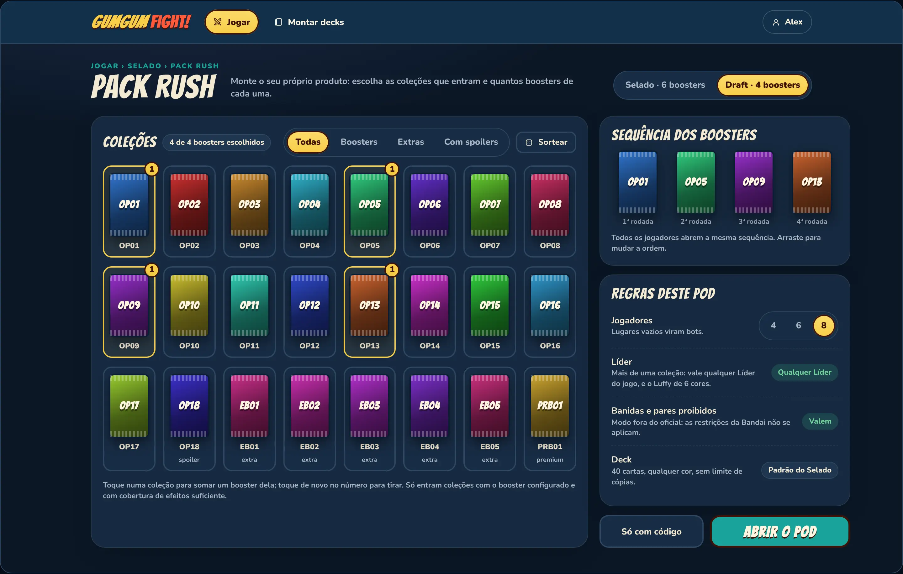
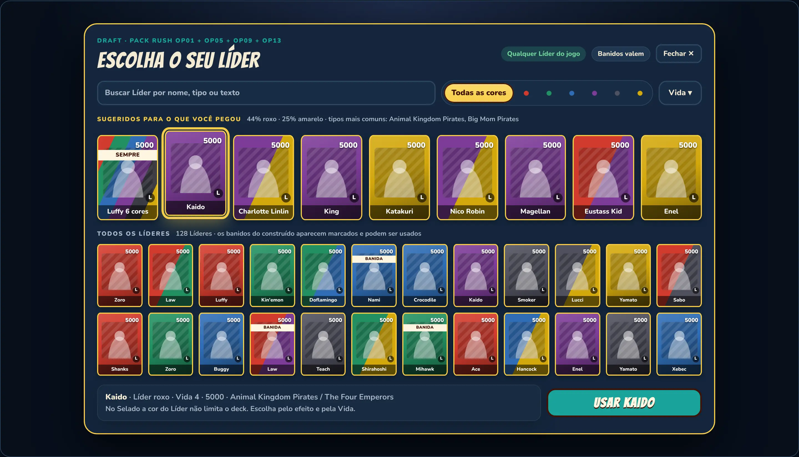

# Plano: novos modos de jogo (All Blue, Selado, Pack Rush, Cubo e Yonko)

> Status (21/11/2026): **All Blue, Pré-release (Selado de uma coleção), Pack Rush (selado e draft) e Draft
> implementados**; o README (seções "All Blue", "Selado", "Pack Rush" e "Draft") descreve o que existe. Os outros modos seguem como proposta, na ordem da
> seção 1.
> As telas estão em [`docs/mockups/modos-de-jogo/`](mockups/modos-de-jogo/index.html) (abra o `index.html` no navegador;
> as imagens `.webp` da pasta são as mesmas telas). As cartas das telas são ilustrativas e os números são de exemplo.

## 1. Resumo

| Modo | O que é | Tamanho | Mexe no motor? | Maior risco |
|---|---|---|---|---|
| **All Blue** ✅ | Formato da comunidade no estilo Pauper: só cartas C, UC, R e promos (sem SR e sem SEC). Partida 1x1 normal. | Pequeno | Não | Qualidade do campo `rarity` das cartas |
| **Selado: Pré-release** ✅ | O jogador abre 6 boosters de uma coleção e monta um deck de 40 com o que saiu. | Médio | Pouco (tamanho do deck) | Fidelidade do booster e cartas ⚙ na coleção |
| **Selado: Draft** ✅ | Pod de 8 (bots nos lugares vazios): cada um abre um booster, pega 1 carta e passa o resto. Deck de 40. | Médio para grande (em cima do Pré-release) | Não | Sala em tempo real nova e bots que escolhem |
| **Pack Rush** ✅ (selado e draft) | Selado ou Draft com boosters de **coleções variadas**; quem abre o pod escolhe quais entram. | Pequeno (em cima do Selado e do Draft) | Não | Booster configurado e cobertura de efeitos em **todas** as coleções, não só na mais nova |
| **Draft Cubo** | Draft num conjunto fixo com as **cartas mais usadas** de One Piece, de todas as coleções. | Pequeno para médio (em cima do Draft) | Não | Manter a lista boa: curadoria a cada temporada |
| **Yonko** | Mesa de 4, todos contra todos, formato da comunidade inspirado no Commander. | Muito grande | **Sim**, bastante | O motor, a mesa e o bot foram feitos para 2 jogadores |

Em esforço relativo, com o All Blue valendo 1: Pré-release ≈ 3, Draft ≈ +2, Pack Rush ≈ +1, Cubo ≈ +1,5 e Yonko ≈ 8
ou mais. O Yonko é o único que muda o motor de regras; os outros são regras de deck e telas novas em volta da partida
que já existe.

**Ordem sugerida:** All Blue → Pré-release → Pack Rush selado → Draft (já com Pack Rush) → Cubo → Selado nos torneios →
Yonko. Cada passo é entregável sozinho, e dá para parar depois de qualquer um.

De onde vêm as regras: All Blue, Pack Rush, Cubo e Yonko são formatos de fã, definidos por você nesta conversa. O
Selado segue o que a Bandai publica; o Draft não tem regra oficial que eu tenha encontrado, então a proposta é nossa.

## 2. All Blue

### Regras

- Vale toda carta lançada com raridade **C, UC, R ou promo (P/PR)**. **SR e SEC ficam de fora.**
- O Líder (raridade L) é livre.
- **Nenhuma carta banida.** As banidas, os pares proibidos e a rotação da Bandai não se aplicam. A lista de banidas do
  All Blue é própria e começa vazia; uma carta entra nela se as reclamações mostrarem que ela desbalanceia o formato.
- O resto é o jogo normal: 1 Líder, 50 cartas, até 4 cópias, cor do Líder.
- A raridade é a do número da carta. Arte alternativa (Parallel, SP, Manga) não muda nada: uma SR com arte promocional
  continua SR.

### Como ficou

- **Formato novo (`allblue`) em `packages/engine/src/formats.ts`:** `cardLegality` e `formatIssues` passaram a receber
  o catálogo, porque a regra depende da raridade. Carta sem raridade conhecida fica fora (`rules.rarityUnknown`), para
  uma SR não passar por falta de dado. `ALL_BLUE_BANNED` é a lista própria, vazia.
- **Onde se joga:** fila casual própria, sala privada, treino contra o bot e torneios. Sem ranqueada (`hasRanked`) e
  fora das estatísticas do construído (`countsInStats`).
- **Decks prontos:** seis em `data/decks/allblue/` (os primeiros starters sem as SR), num grupo à parte para não
  entrarem no sorteio do oponente nem na Sala do Tempo dos outros formatos.
- **Interface:** terceiro formato na tela inicial, selo "All Blue" nos decks que valem, "Montar para o All Blue" no
  construtor (filtra o catálogo e marca o que não vale) e o atalho `allblue` na busca. Textos nos seis idiomas.
- **Auditoria:** `npm run cards:check-rarity -w @gumgum/server` lista as cartas sem raridade conhecida.

### Diferenças para as telas da proposta

- O construtor não tem o seletor "Montando para" com os três formatos nem a barra de raridades do deck: ficou uma
  opção só, "Montar para o All Blue", que esconde do catálogo o que não vale (em vez de mostrar apagado).
- A tela inicial não tem o cartão explicativo do All Blue na fileira de modos especiais (essa fileira entra com o
  Selado e o Yonko). Com o formato escolhido, a faixa do deck mostra "Só C, UC, R e promo".

### Em aberto

1. **Ranqueada:** ficou só casual, como recomendado. Abrir uma ranqueada do All Blue é ligar o formato em `hasRanked`.
2. **Estatísticas:** as partidas são gravadas, mas fora das telas de estatísticas. Um meta próprio do All Blue pede uma
   aba separada, para não misturar com Standard e EGB.

## 3. Modos limitados: Selado, Draft, Pack Rush e Cubo

### O que já existe (Pré-release, Pack Rush e Draft)

O **Draft** entrou com pod de 8 e bots nos lugares vazios (decisão 3): código de 6 letras para chamar os amigos, 4
boosters de 12 cartas por jogador, prazo por escolha (46 s caindo até 13 s) com escolha automática do servidor, e o
Pack Rush draft pelas coleções marcadas. As escolhas viram um deck selado, e a sala privada desse deck só aceita
decks do mesmo pod. Diferenças para as telas 5 a 7: não há link de convite (é o código), a tela consulta o servidor a
cada segundo em vez de ficar numa conexão aberta, e depois do draft não há chave entre os 8: cada um joga com quem
quiser do pod, ou contra um dos bots que draftaram. Ficou para depois: fila pública de pods, rodadas ou chave dentro
do pod, torneio de Draft e o Draft Cubo.

O Pack Rush selado entrou na mesma tela: escolher de 2 a 12 coleções, 6 boosters sorteados entre elas, qualquer Líder
do jogo (com a folha de escolha da tela 12) e sala privada entre decks das mesmas coleções. Diferenças para a tela 10:
não há "pod" com vários jogadores nem o botão de sortear coleções; cada jogador abre os próprios boosters e a sala
privada confere que os dois escolheram as mesmas coleções. O pod de verdade existe no Draft.

Abrir 6 boosters de uma coleção, montar o deck de 40 (com "Montar sozinho"), o Líder de 6 cores e jogar contra o bot
ou em sala privada, com o servidor sorteando e conferindo tudo. Ficou para os próximos passos:

- **Fila do Selado** e **torneio de Selado** (hoje só bot e sala privada).
- **Abertura de coleção de spoiler por um Admin:** hoje a coleção entra sozinha quando está completa no banco e com
  70% dos efeitos automatizados.
- **Modelo de booster por coleção** (`data/boosters/`): hoje todas usam o padrão do motor (7 C, 3 UC, 1 rara ou
  melhor, 1 Líder em 1/3 dos boosters).
- **Relógio de montagem** (30 minutos): só faz sentido em evento; sozinho, o jogador monta no próprio tempo.
- A carta do Luffy de 6 cores não tem número na lista oficial (o P-047 é outro Luffy), então entrou com id próprio
  (`SEALED-001`).

### Os cinco modos são duas escolhas

Todos saem da mesma tela: primeiro **de onde vêm as cartas**, depois **como o jogador monta**.

| De onde vêm as cartas | Selado (abre sozinho) | Draft (pod, pega 1 e passa) | Líder |
|---|---|---|---|
| **Uma coleção** | Pré-release | Draft | Os que o jogador abrir ou pegar, ou o **Luffy de 6 cores** |
| **Pack Rush** (várias coleções, escolhidas por quem abre o pod) | Pack Rush selado | Pack Rush draft | **Qualquer Líder do jogo** |
| **Cubo** (as cartas mais usadas) | não existe | Draft Cubo | **Qualquer Líder do jogo** |

Por baixo é um motor só: uma "fonte de boosters" (coleção, lista de coleções ou cubo) e duas formas de distribuir as
cartas. Por isso Pack Rush e Cubo custam pouco depois que Selado e Draft existem.

### Regras comuns a todos

- Deck de **40 cartas** + 1 Líder + 10 DON!!, só com as cartas abertas ou draftadas.
- **A cor do Líder não limita o deck** e não há limite de cópias.
- **Banidas e pares proibidos valem.** Nenhum desses modos é formato oficial de torneio, então a lista de restrições da
  Bandai (`BANNED_CARDS`, `BANNED_PAIRS`) e a rotação do Standard não se aplicam. Uma carta banida pode sair num
  booster, estar no Cubo e ser jogada; um Líder banido pode ser escolhido no Pack Rush e no Cubo.
- As partidas ficam fora das estatísticas e do meta do construído.

### Líder

- **Uma coleção (Pré-release e Draft):** o jogador usa um Líder que abriu ou pegou no draft, ou o **Luffy de 6 cores**,
  que todo jogador tem sempre. É a regra dos eventos Sealed Battle da Bandai: o Líder de 6 cores existe para ninguém
  ficar sem Líder, seja qual for a cor que sair.
- **Mais de uma coleção (Pack Rush e Cubo):** vale **qualquer Líder do jogo**, escolhido na montagem do deck, além do
  Luffy de 6 cores. Como são mais de cem Líderes, o seletor sugere primeiro os das cores e dos tipos que o jogador mais
  pegou (tela 12).
- Com o Luffy garantido, o booster simulado **não precisa mais trazer um Líder por pacote**: pode seguir a
  distribuição do produto real.
- **A carta:** Vida 5, 5000, Strike, Straw Hat Crew, "treated as a card with all card names, types, and attributes".
  Não tem número impresso; no app é `SEALED-001`.

### Selado e Draft com uma coleção

| Ponto | Proposta | Observação |
|---|---|---|
| Boosters no Pré-release | 6 por jogador (72 cartas) | É o número dos eventos Sealed Battle oficiais. |
| Draft | Pod de 4 a 8, **4 boosters** por jogador, 12 cartas cada (48 escolhas) | Sem regra oficial. Com 3 boosters não dá para chegar a 40. |
| Tempo | 30 min para montar; no Draft, 45 s por escolha, caindo conforme o booster esvazia | Sem escolha no tempo, o servidor escolhe. |

**Modelo do booster** (por coleção, em `data/boosters/<coleção>.json`, não no código): 7 comuns, 3 incomuns, 1 vaga de
rara ou melhor (R, SR ou SEC, com pesos) e 1 vaga variável (Líder ou carta extra). As proporções de cada produto
precisam ser conferidas na ficha da coleção. Um modelo padrão vale para as coleções sem arquivo próprio.

O **pré-release de verdade** sai de graça daqui: a coleção de spoiler que o app já acompanha (`data/spoilers`, hoje
EB05 e OP18) vira opção quando estiver completa o bastante. Quem decide que ela abriu é um Admin.

### Pack Rush

- **Quem abre o pod escolhe as coleções** que entram (tela 10).
- **Cada jogador recebe boosters sorteados entre as coleções escolhidas** (6 no selado, 4 no draft): dois jogadores do
  mesmo pod podem abrir coleções diferentes. No draft, o booster passa de mão em mão normalmente; só muda que os
  boosters de uma mesma rodada podem ser de coleções diferentes.
- Pack Rush é sempre um pod ou uma sala criada por alguém. Para jogar sozinho contra o bot, o jogador abre um pod só
  dele.
- Só entram na lista as coleções com booster configurado e cobertura de efeitos acima do piso. É aqui que mora o custo
  do Pack Rush: o Selado de uma coleção só exige cuidar da coleção nova; o Pack Rush exige cuidar de todas.
- Coleções de spoiler podem entrar se quem abre o pod marcar; os Líderes de spoiler só valem nesse caso.

### Draft Cubo

- O **Cubo** é uma lista fixa em `data/cubes/<id>.json`: 420 cartas, **uma cópia de cada**, 70 por cor, com curva de
  custo equilibrada. Sem Líderes (o Líder é livre).
- **De onde sai a lista:** das **estatísticas de uso globais** (o meta global do TCG Matchmaking, que o app já
  baixa), e não só das partidas do GumGum Fight. Um script gera a lista (mais usadas por cor), publicada como
  "temporada". Cartas ⚙ (efeito não automatizado) não entram. Uma lista montada à mão por você fica para depois; o
  arquivo da temporada já é editável.
- **Os boosters** são 12 cartas sorteadas do Cubo, sem vaga de raridade e sem repetir carta no pod. Um pod de 8 usa 384
  das 420.
- A página do Cubo (tela 11) mostra a lista inteira e o uso de cada carta antes de o jogador entrar.

### Como o jogador joga com o deck

Depois de montar, o deck selado é um deck de verdade, mas preso àquelas cartas:

- **Contra o bot** e **sala privada**, na hora.
- **Fila do Selado:** pareia só decks da mesma fonte (mesma coleção; Pack Rush e Cubo jogam dentro do pod).
- **Pod:** os jogadores do pod se enfrentam (pod de 4: semifinal e final; pod de 8: 3 rodadas de suíço),
  reaproveitando o módulo de torneios.
- **Evento** (fase seguinte): o organizador cria um torneio com "deck: Selado OP18", "Pack Rush" ou "Cubo"; no início,
  cada inscrito recebe os boosters ou entra no draft, há a fase de montagem com relógio e o deck congela, como já
  congela a lista na inscrição hoje.

### O que muda no código

- **Fonte de boosters (`packages/engine/src/sealed.ts`, novo):** função pura com seed. Três fontes com a mesma
  interface: `set` (modelo do booster da coleção), `mix` (uma coleção por posição) e `cube` (sorteio sem reposição).
- **Servidor é a autoridade (`apps/server/src/sealed/`, novo):** as cartas de cada jogador são sorteadas e gravadas no
  servidor (`sealed_pools`: dono, fonte, seed, cartas, tipo; `sealed_decks`: a lista de 40). O cliente só revela. Antes
  de cada partida o servidor confere que o deck sai daquelas cartas.
- **Regras de construção (`deck.ts`, `formats.ts`):** `validateDeck` ganha um perfil de regras (`constructed` ou
  `limited`): tamanho 40, sem cor, sem limite de cópias, cartas ⊆ as do jogador, e a regra do Líder (`pool` = Líder
  aberto ou Luffy de 6 cores; `any` = qualquer Líder). No perfil `limited`, `formatIssues` não roda: nem banidas, nem
  pares, nem rotação.
- **Motor (`engine.ts`):** `createGame` recusa deck diferente de 50 (`DECK_SIZE`). Passa a aceitar o tamanho pela
  configuração da partida. É a única mudança no motor; replays e partidas antigas não mudam.
- **Construtor:** um modo "coleção" do `DeckBuilder` (catálogo = suas cartas, com contador de cópias) em vez de uma
  tela nova, mais o seletor de Líder. "Montar sozinho" usa uma heurística simples (curva, Counters, cor dominante).
- **Draft (`apps/server/src/draft/`, novo):** sala em tempo real pelo mesmo transporte das partidas (SSE + POST):
  lugares, boosters em rodízio, relógio por escolha, reconexão, e retomada depois de deploy (gravar o estado, como
  `live_matches`). Bots de draft escolhem por uma nota simples (raridade, custo, poder, palavra-chave; no Cubo, o uso
  da carta).
- **Cubo:** o script que gera a proposta a partir das estatísticas, o arquivo da temporada, a página da lista e uma
  tela de Admin para revisar e publicar.
- **Idiomas:** todo texto novo nos seis idiomas da interface.

### Riscos

- **Cartas ⚙ (efeito não automatizado):** no construído o jogador evita; no Selado elas saem no booster. Proposta:
  a coleção só entra acima de um piso de cobertura, e a carta ⚙ aparece marcada na abertura. No Cubo elas ficam de fora.
- **Qualquer Líder com qualquer cor:** sem a trava de cor, alguns Líderes ficam muito acima dos outros no Pack Rush e
  no Cubo. É esperado num modo por diversão; se virar problema, dá para ter uma lista de Líderes fora desses modos.
- **Coleção de spoiler incompleta:** sem todas as cartas e raridades não dá para montar booster. Por isso a abertura é
  uma decisão de Admin, não automática.
- **Bot com deck de 40 sem perfil:** o bot genérico joga qualquer lista, mas pior que com os decks do meta. Aceitável
  para treino.

### Decisões

Já decididas por você: Líder (Luffy de 6 cores nos modos de uma coleção; qualquer Líder nos de várias), banidas (valem
em todos os modos limitados), Pack Rush (boosters sorteados por jogador entre as coleções escolhidas) e Cubo (uma cópia
de cada, lista pelas estatísticas globais) e Draft (pod de 8 com bots completando os lugares vazios).

4. **Vida do deck selado:** jogar à vontade enquanto a fonte estiver no ar (o que as telas mostram), ou formato de
   "corrida" que termina com X derrotas?

## 4. Yonko (mesa de 4)

### Regras propostas ("Padrão GumGum v1")

Partindo do que você descreveu, fechando os pontos que o formato da comunidade deixa em aberto:

- **4 jogadores**, cada um com um deck construído normal (50 cartas), todos no mesmo formato.
- **Ordem:** cada um rola o dado (o `DiceRoll` que já existe); o maior começa e a mesa segue no sentido horário.
- **Início:** o 1º não compra no primeiro turno e recebe 1 DON!!, como hoje. Ninguém ataca no próprio primeiro turno.
  O 3º e o 4º escolhem um bônus: **+1 carta na mão inicial** ou **+1 DON!! no primeiro turno**.
- **Vida:** a impressa no Líder **+2**.
- **Ataque:** cada ataque escolhe o alvo em qualquer mesa (Líder ou Personagem virado de qualquer oponente). Só o
  defensor usa Blocker e Counter.
- **Eliminação:** dano no Líder sem Vida, ou deck vazio. As cartas do eliminado saem do jogo e os efeitos dele acabam.
  Quem deu o golpe final compra 1 carta. O último de pé vence; os outros ficam em 2º, 3º e 4º pela ordem de queda.
- **Relógio:** 25 minutos por jogador (hoje são 17:30 no 1x1), correndo só nas decisões dele. Sem tempo ou 2 minutos
  desconectado na própria decisão: eliminado, e a mesa segue.

Vida extra, bônus de início, recompensa e relógio são opções da sala, com esses valores como padrão.

### A regra dos efeitos em "seu oponente"

É o ponto que decide o tamanho do trabalho. As cartas foram escritas para dois jogadores, e reescrever efeito por
efeito não é viável. A proposta são três regras gerais, aplicadas pelo motor a qualquer carta:

1. **Em batalha**, "seu oponente" é o outro jogador da batalha.
2. **Fora de batalha**, quem usa o efeito **escolhe um oponente** quando o efeito começa a resolver. Todo "seu
   oponente" daquele efeito (condições, alvos, descartes) aponta para o escolhido.
3. **Efeitos contínuos** e **[Opponent's Turn]** valem para todos os oponentes e para o turno de qualquer um deles.

Com dois jogadores as três regras dão o mesmo resultado de hoje, então o 1x1 não muda (replays, testes e
estatísticas continuam idênticos).

### O que muda no código

- **Motor (`packages/engine`):** `PlayerId` deixa de ser `0 | 1` e o estado passa a ter N jogadores. A função
  `opponent(p)` tem 56 usos em `engine.ts`; cada um vira uma de três funções (`battleOpponent`, `focusOpponent`,
  `opponents`), conforme as regras acima. Entram: a decisão nova `chooseOpponent` (só abre com mais de um oponente
  vivo), a ordem de turno que pula eliminados, a eliminação com limpeza das zonas, e a visão por jogador (`view.ts`)
  para N lugares.
- **Servidor (`online/room.ts`, `lobby.ts`):** a sala assume 2 lugares (`seats.length !== 2`). Passa a N lugares, com
  relógio, reconexão, abandono que elimina em vez de encerrar, e a gravação para retomar depois de deploy.
- **Interface:** uma mesa nova (`YonkoBoard`), não uma adaptação de `Board`/`WideBoard`: três oponentes compactos em
  cima, a sua mesa embaixo, alvos acesos nas três mesas ao atacar. No celular, os oponentes viram abas. `GameScreen.tsx`
  (3.800 linhas) concentra muita lógica de dois lados e é onde mora a maior parte do trabalho de interface.
- **Replay e espectador:** o formato do replay e o modo espectador passam a aceitar N jogadores.
- **Bot:** o planejador (`bot/planner.ts`, `evaluate.ts`) avalia uma posição contra um oponente. Para a v1, um bot
  simples que escolhe o alvo por heurística (quem está mais perto de cair, quem ameaça mais) serve para completar mesa;
  não vai jogar bem.
- **Fora das estatísticas e do bounty.**

### Fases do Yonko, com ponto de parada

1. **Motor com N jogadores, sem tela:** regras, eliminação, `chooseOpponent`, e uma simulação de milhares de partidas
   de 4 bots simples para achar cartas que quebram. **Ponto de decisão:** se a lista de cartas problemáticas for longa
   demais, paramos aqui sem ter gasto com tela.
2. **Sala e servidor** para 4 humanos (sala privada com código).
3. **Mesa** no computador e no celular.
4. **Bot** para completar mesa, espectador e replay.

### Fora da v1

Mesa de 3, fila pública, torneio de Yonko, alianças formais, 2 contra 2 e bot competitivo.

### Decisões que são suas

5. **Regra dos efeitos:** as três regras acima servem, ou a sua mesa joga diferente (por exemplo, efeitos em área
   atingindo todos os oponentes)?
6. **Recompensa por eliminação:** comprar 1 carta, outra coisa, ou nada?
7. **Bot na v1:** aceitar o bot fraco para completar mesa, ou lançar só para 4 humanos?

## 5. O que não muda

- As partidas 1x1, as filas, a ranqueada, os torneios e os replays de hoje.
- O motor continua puro e determinístico; tudo que é sorteio novo (boosters, ordem da mesa) usa seed e é reproduzível.
- O servidor continua sendo a autoridade: boosters, coleções de cartas e escolhas do draft são sorteados e conferidos
  lá, nunca no navegador.

## 6. Fontes

- Selado: as páginas dos eventos [Sealed Battle 2023 Vol.1](https://en.onepiece-cardgame.com/events/2023/sealed_battle_vol1/)
  e [Sealed Battle 2024 Vol.1](https://en.onepiece-cardgame.com/events/2024/sealed_battle_vol1/) confirmam os 6
  boosters e o Líder de 6 cores. Regras de deck: [Tournament Rules Manual](https://en.onepiece-cardgame.com/pdf/tournament_rules_manual.pdf?20260116)
  e [5 Packs Battle Rules](https://asia-en.onepiece-cardgame.com/pdf/rule_5packs-battle.pdf) (Bandai).
- Regras para mais de 2 jogadores: as [Comprehensive Rules](https://en.onepiece-cardgame.com/pdf/rule_comprehensive.pdf)
  dizem que o jogo é para dois e que não há regra oficial para três ou mais. O Yonko é regra da casa.
- Eventos temáticos oficiais (referência para listas de Líderes): [Pirates Party 2026 Vol. 3](https://en.onepiece-cardgame.com/events/pirates-party-vol3-2026.html).
