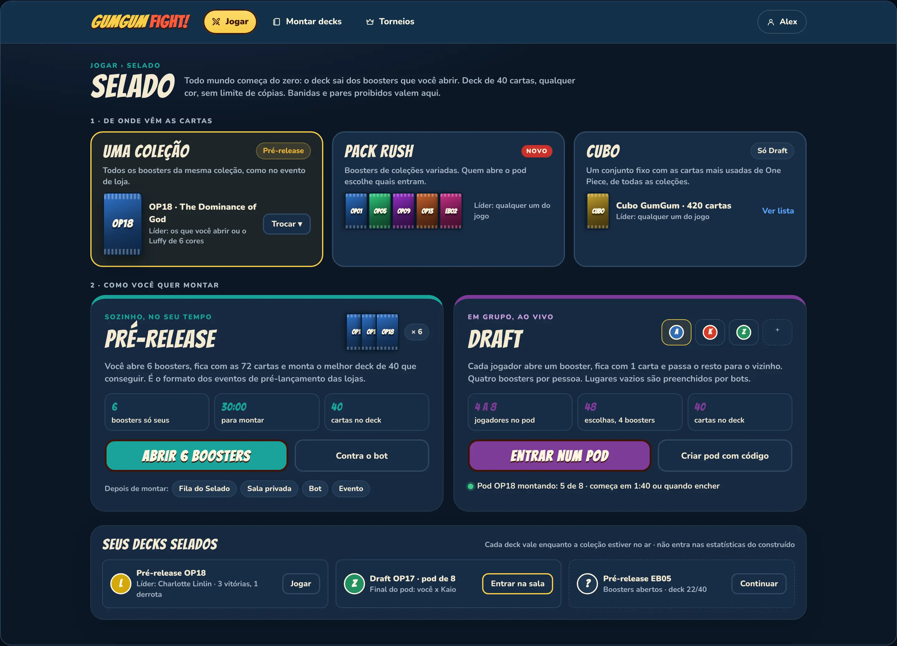
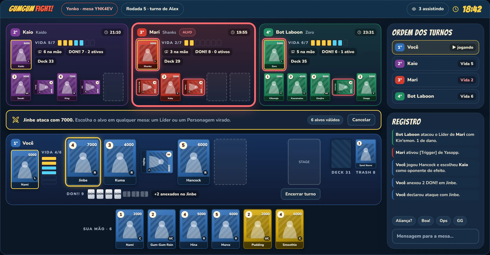
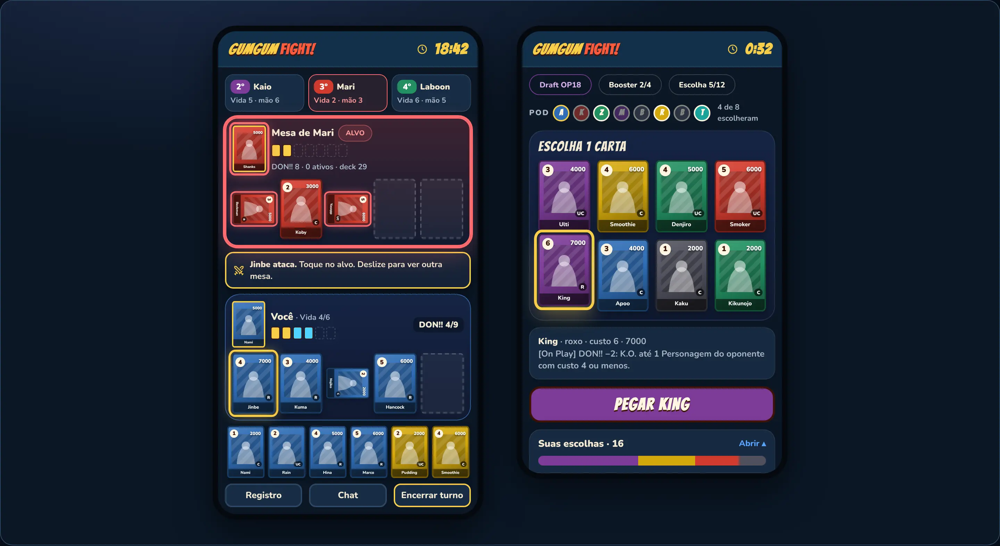

# Plano: novos modos de jogo (All Blue, Selado e Yonko)

> Status: **proposta** (21/11/2026), à espera da decisão de seguir. Nada aqui está implementado.
> As telas estão em [`docs/mockups/modos-de-jogo/`](mockups/modos-de-jogo/index.html) (abra o `index.html` no navegador;
> as imagens `.webp` da pasta são as mesmas telas). As cartas das telas são ilustrativas e os números são de exemplo.

## 1. Resumo

| Modo | O que é | Tamanho | Mexe no motor? | Maior risco |
|---|---|---|---|---|
| **All Blue** | Formato da comunidade no estilo Pauper: só cartas C, UC, R e promos (sem SR e sem SEC). Partida 1x1 normal. | Pequeno | Não | Qualidade do campo `rarity` das cartas |
| **Selado: Pré-release** | O jogador abre 6 boosters de uma coleção e monta um deck de 40 com o que saiu. | Médio | Pouco (tamanho do deck) | Fidelidade do booster e cartas ⚙ na coleção |
| **Selado: Draft** | Pod de 4 a 8: cada um abre um booster, pega 1 carta e passa o resto. Deck de 40. | Médio para grande (em cima do Pré-release) | Não | Sala em tempo real nova e bots que escolhem |
| **Yonko** | Mesa de 4, todos contra todos, formato da comunidade inspirado no Commander. | Muito grande | **Sim**, bastante | O motor, a mesa e o bot foram feitos para 2 jogadores |

Em esforço relativo, com o All Blue valendo 1: Pré-release ≈ 3, Draft ≈ +2 (reaproveita o Pré-release) e Yonko ≈ 8 ou
mais. O Yonko é o único que muda o motor de regras; os outros três são regras de deck e telas novas em volta da partida
que já existe.

**Ordem sugerida:** All Blue → Pré-release → Draft → Selado nos torneios → Yonko. Cada passo é entregável sozinho, e dá
para parar depois de qualquer um.

De onde vêm as regras: All Blue e Yonko são formatos de fã, definidos por você nesta conversa (não achei um regulamento
público de nenhum dos dois). O Selado segue o que a Bandai publica; o Draft não tem regra oficial que eu tenha
encontrado, então a proposta é nossa.

## 2. All Blue

### Regras

- Vale toda carta lançada com raridade **C, UC, R ou promo (P/PR)**. **SR e SEC ficam de fora.**
- O Líder (raridade L) é livre.
- O resto é o jogo normal: 1 Líder, 50 cartas, até 4 cópias, cor do Líder.
- A raridade é a do número da carta. Arte alternativa (Parallel, SP, Manga) não muda nada: uma SR com arte promocional
  continua SR.

### Onde entra

All Blue vira um terceiro `FormatId`, ao lado de `standard` e `egb` (`packages/engine/src/formats.ts`). Com isso ele
herda quase tudo o que um formato já tem: o seletor da tela inicial, a fila casual própria, as salas privadas, o treino
contra o bot, os torneios, o selo "Válido no All Blue" no construtor e o menu que desabilita decks que não valem.

### O que muda no código

- **`formats.ts`:** `cardLegality` e `formatIssues` hoje olham só o número da carta. Para o All Blue precisam da
  raridade, então passam a receber o catálogo (`Map<string, CardData>`), como `validateDeck` já recebe. Nova
  legalidade `'rarity'` e nova mensagem `rules.rarity` ("OP06-047 é SR: não vale no All Blue").
- **Construtor (`DeckBuilder.tsx`, `cardSearch.ts`):** selo do formato, cartas SR/SEC apagadas no catálogo quando o
  formato de montagem é All Blue, e a barra de raridades do deck. O filtro de raridade já existe na busca (`r:uc`, `sr`).
- **Fila e contadores (`online/lobby.ts`):** as filas já são por `FormatId`; a ranqueada do All Blue fica desligada no
  começo.
- **Bot:** 4 a 6 decks prontos em `data/decks/allblue/`, para o treino ter oponente e o jogador novo ter por onde começar.
- **Estatísticas:** meta próprio por formato (as tabelas já separam por formato) ou fora das estatísticas no começo.
- **Auditoria de raridade:** um script que lista cartas sem `rarity` ou com valor fora do esperado. Carta sem raridade
  conhecida fica **fora** do All Blue até ser corrigida (aparece na tela de Cobertura), para o formato não vazar SR.

### Decisões que são suas

1. **Base de cartas:** todas as coleções (como o EGB) com a lista de banidas oficial. É o que as telas assumem. A
   alternativa é seguir a rotação do Standard.
2. **Lista de banidas própria:** começar vazia e ajustar pelo meta que aparecer?
3. **Ranqueada:** só casual no lançamento (recomendado) ou já com bounty?

## 3. Selado (Pré-release e Draft)

### Regras

O que a Bandai define para o Selado (Tournament Rules Manual e regras de Sealed Battle):

- Deck de **40 cartas** + 1 Líder + 10 DON!!, só com cartas dos boosters abertos.
- **A cor do Líder não limita o deck.**
- Sem lista de banidas.

O que é escolha nossa (a regra oficial varia por evento ou não existe):

| Ponto | Proposta | Observação |
|---|---|---|
| Boosters no Pré-release | 6 por jogador (72 cartas) | É o número usual dos eventos de loja. |
| Limite de cópias | Sem limite | O evento oficial "5 Packs Battle" declara isso por escrito; no Selado, na prática, quase não importa. |
| Líder no Pré-release | Qualquer Líder que sair nos boosters; cada booster simulado traz 1 Líder | No booster real o Líder não vem em todo pacote. Garantir um por booster evita coleção sem Líder jogável. |
| Draft | Pod de 4 a 8, **4 boosters** por jogador, 12 cartas cada (48 escolhas), deck de 40 | Sem regra oficial. Com 3 boosters não dá para chegar a 40. |
| Líder no Draft | Antes do draft, cada jogador recebe 3 Líderes da coleção e fica com 1; os boosters do Draft não trazem Líder | Evita gastar escolhas com Líder e ninguém fica sem. |
| Tempo | 30 min para montar; no Draft, 45 s por escolha, caindo conforme o booster esvazia | Sem escolha no tempo, o servidor escolhe. |

**Modelo do booster** (por coleção, configurável em dados): 7 comuns, 3 incomuns, 1 vaga de rara ou melhor (R, SR ou
SEC, com pesos) e 1 vaga de Líder (Pré-release) ou de carta extra (Draft). As proporções exatas de cada produto
precisam ser conferidas na ficha da coleção antes de fechar; fica num arquivo `data/boosters/<coleção>.json`, não no
código.

### Como o jogador joga com o deck selado

Depois de montar, o deck selado é um deck de verdade, mas preso àquela coleção de cartas:

- **Contra o bot** e **sala privada**, na hora.
- **Fila do Selado:** pareia só decks selados da mesma coleção.
- **Pod do Draft:** os jogadores do pod se enfrentam (pod de 4: semifinal e final; pod de 8: 3 rodadas de suíço),
  reaproveitando o módulo de torneios.
- **Evento** (fase seguinte): o organizador cria um torneio com "deck: Selado OP18"; no início, cada inscrito recebe os
  boosters, há a fase de montagem com relógio e o deck congela, como já congela a lista na inscrição hoje.

O **pré-release de verdade** sai de graça daqui: a coleção de spoiler que o app já acompanha (`data/spoilers`, hoje
EB05 e OP18) vira opção do Selado quando estiver completa o bastante. Quem decide que ela abriu é um Admin.

### O que muda no código

- **Geração dos boosters (`packages/engine/src/sealed.ts`, novo):** função pura com seed
  (`openPacks(set, n, seed, modelo)`), testável e reproduzível como o resto do motor.
- **Servidor é a autoridade (`apps/server/src/sealed/`, novo):** a coleção de cartas de cada jogador é sorteada e
  gravada no servidor (`sealed_pools`: dono, coleção, seed, cartas, tipo; `sealed_decks`: a lista de 40). O cliente só
  revela. Antes de cada partida o servidor confere que o deck sai daquela coleção.
- **Regras de construção (`deck.ts`):** `validateDeck` ganha um perfil de regras (`constructed` ou `sealed`): tamanho
  40, sem cor, sem limite de cópias, cartas ⊆ coleção, Líder ∈ coleção.
- **Motor (`engine.ts`):** `createGame` recusa deck diferente de 50 (`DECK_SIZE`). Passa a aceitar o tamanho pela
  configuração da partida. É a única mudança no motor; replays e partidas antigas não mudam.
- **Construtor:** um modo "coleção" do `DeckBuilder` (catálogo = suas cartas, com contador de cópias) em vez de uma
  tela nova. "Montar sozinho" usa uma heurística simples (curva, Counters, cor dominante).
- **Draft (`apps/server/src/draft/`, novo):** sala em tempo real pelo mesmo transporte das partidas (SSE + POST):
  lugares, boosters em rodízio, relógio por escolha, reconexão, e retomada depois de deploy (gravar o estado, como
  `live_matches`). Bots de draft escolhem por uma nota simples (raridade, custo, poder, palavra-chave).
- **Estatísticas:** partidas do Selado ficam fora do meta do construído (`countsInStats`). Um placar próprio por deck
  selado (vitórias e derrotas) basta.
- **Idiomas:** todo texto novo nos seis idiomas da interface.

### Riscos

- **Cartas ⚙ (efeito não automatizado):** no construído o jogador evita; no Selado elas saem no booster. Proposta:
  a coleção só entra no Selado acima de um piso de cobertura, e a carta ⚙ aparece marcada na abertura.
- **Coleção de spoiler incompleta:** sem todas as cartas e raridades não dá para montar booster. Por isso a abertura é
  uma decisão de Admin, não automática.
- **Bot com deck de 40 sem perfil:** o bot genérico joga qualquer lista, mas pior que com os decks do meta. Aceitável
  para treino.

### Decisões que são suas

4. **Líder:** como na tabela (1 por booster no Pré-release; 1 de 3 no Draft), ou outra regra?
5. **Draft:** pod de 8 com bots completando, ou só pods de 4 para encher mais rápido?
6. **Vida do deck selado:** jogar à vontade enquanto a coleção estiver no ar (o que as telas mostram), ou formato de
   "corrida" que termina com X derrotas?

## 4. Yonko (mesa de 4)

### Regras propostas ("Padrão GumGum v1")

Partindo do que você descreveu, fechando os pontos que o formato da comunidade deixa em aberto:

- **4 jogadores**, cada um com um deck construído normal (50 cartas), todos no mesmo formato.
- **Ordem:** cada um rola o dado (o `DiceRoll` que já existe); o maior começa e a mesa segue no sentido horário.
- **Início:** o 1º não compra no primeiro turno e recebe 1 DON!!, como hoje. Ninguém ataca no próprio primeiro turno.
  O 3º e o 4º escolhem um bônus: **+1 carta na mão inicial** ou **+1 DON!! no primeiro turno**.
- **Vida:** a impressa no Líder **+2**.
- **Ataque:** cada ataque escolhe o alvo em qualquer mesa (Líder ou Personagem virado de qualquer oponente). Só o
  defensor usa Blocker e Counter.
- **Eliminação:** dano no Líder sem Vida, ou deck vazio. As cartas do eliminado saem do jogo e os efeitos dele acabam.
  Quem deu o golpe final compra 1 carta. O último de pé vence; os outros ficam em 2º, 3º e 4º pela ordem de queda.
- **Relógio:** 25 minutos por jogador (hoje são 17:30 no 1x1), correndo só nas decisões dele. Sem tempo ou 2 minutos
  desconectado na própria decisão: eliminado, e a mesa segue.

Vida extra, bônus de início, recompensa e relógio são opções da sala, com esses valores como padrão.

### A regra dos efeitos em "seu oponente"

É o ponto que decide o tamanho do trabalho. As cartas foram escritas para dois jogadores, e reescrever efeito por
efeito não é viável. A proposta são três regras gerais, aplicadas pelo motor a qualquer carta:

1. **Em batalha**, "seu oponente" é o outro jogador da batalha.
2. **Fora de batalha**, quem usa o efeito **escolhe um oponente** quando o efeito começa a resolver. Todo "seu
   oponente" daquele efeito (condições, alvos, descartes) aponta para o escolhido.
3. **Efeitos contínuos** e **[Opponent's Turn]** valem para todos os oponentes e para o turno de qualquer um deles.

Com dois jogadores as três regras dão o mesmo resultado de hoje, então o 1x1 não muda (replays, testes e
estatísticas continuam idênticos).

### O que muda no código

- **Motor (`packages/engine`):** `PlayerId` deixa de ser `0 | 1` e o estado passa a ter N jogadores. A função
  `opponent(p)` tem 56 usos em `engine.ts`; cada um vira uma de três funções (`battleOpponent`, `focusOpponent`,
  `opponents`), conforme as regras acima. Entram: a decisão nova `chooseOpponent` (só abre com mais de um oponente
  vivo), a ordem de turno que pula eliminados, a eliminação com limpeza das zonas, e a visão por jogador (`view.ts`)
  para N lugares.
- **Servidor (`online/room.ts`, `lobby.ts`):** a sala assume 2 lugares (`seats.length !== 2`). Passa a N lugares, com
  relógio, reconexão, abandono que elimina em vez de encerrar, e a gravação para retomar depois de deploy.
- **Interface:** uma mesa nova (`YonkoBoard`), não uma adaptação de `Board`/`WideBoard`: três oponentes compactos em
  cima, a sua mesa embaixo, alvos acesos nas três mesas ao atacar. No celular, os oponentes viram abas. `GameScreen.tsx`
  (3.800 linhas) concentra muita lógica de dois lados e é onde mora a maior parte do trabalho de interface.
- **Replay e espectador:** o formato do replay e o modo espectador passam a aceitar N jogadores.
- **Bot:** o planejador (`bot/planner.ts`, `evaluate.ts`) avalia uma posição contra um oponente. Para a v1, um bot
  simples que escolhe o alvo por heurística (quem está mais perto de cair, quem ameaça mais) serve para completar mesa;
  não vai jogar bem.
- **Fora das estatísticas e do bounty.**

### Fases do Yonko, com ponto de parada

1. **Motor com N jogadores, sem tela:** regras, eliminação, `chooseOpponent`, e uma simulação de milhares de partidas
   de 4 bots simples para achar cartas que quebram. **Ponto de decisão:** se a lista de cartas problemáticas for longa
   demais, paramos aqui sem ter gasto com tela.
2. **Sala e servidor** para 4 humanos (sala privada com código).
3. **Mesa** no computador e no celular.
4. **Bot** para completar mesa, espectador e replay.

### Fora da v1

Mesa de 3, fila pública, torneio de Yonko, alianças formais, 2 contra 2 e bot competitivo.

### Decisões que são suas

7. **Regra dos efeitos:** as três regras acima servem, ou a sua mesa joga diferente (por exemplo, efeitos em área
   atingindo todos os oponentes)?
8. **Recompensa por eliminação:** comprar 1 carta, outra coisa, ou nada?
9. **Bot na v1:** aceitar o bot fraco para completar mesa, ou lançar só para 4 humanos?

## 5. O que não muda

- As partidas 1x1, as filas, a ranqueada, os torneios e os replays de hoje.
- O motor continua puro e determinístico; tudo que é sorteio novo (boosters, ordem da mesa) usa seed e é reproduzível.
- O servidor continua sendo a autoridade: boosters, coleções de cartas e escolhas do draft são sorteados e conferidos
  lá, nunca no navegador.

## 6. Fontes

- Selado e formatos de evento: [Tournament Rules Manual](https://en.onepiece-cardgame.com/pdf/tournament_rules_manual.pdf?20260116)
  e [5 Packs Battle Rules](https://asia-en.onepiece-cardgame.com/pdf/rule_5packs-battle.pdf) (Bandai). O PDF
  `rule_sealed.pdf` não abriu daqui; vale conferir o número de boosters e a regra do Líder nele antes de fechar.
- Regras para mais de 2 jogadores: as [Comprehensive Rules](https://en.onepiece-cardgame.com/pdf/rule_comprehensive.pdf)
  dizem que o jogo é para dois e que não há regra oficial para três ou mais. O Yonko é regra da casa.
- Eventos temáticos oficiais (referência para listas de Líderes): [Pirates Party 2026 Vol. 3](https://en.onepiece-cardgame.com/events/pirates-party-vol3-2026.html).
