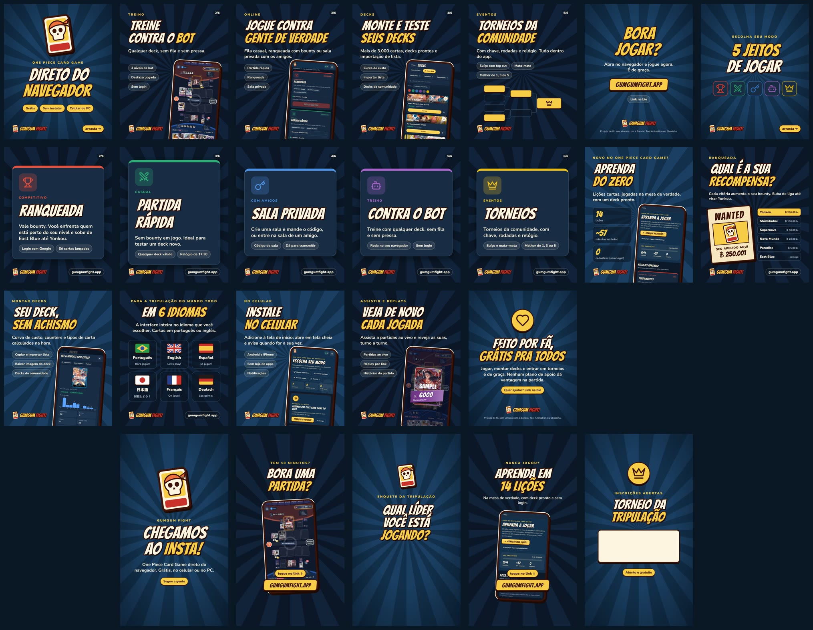

# Kit de Instagram do GumGum Fight

Tudo o que precisa para abrir o perfil e publicar as primeiras três semanas: imagens de perfil, 9 posts
(19 imagens), 5 stories, 3 Reels, as legendas prontas para colar e o [planejamento](planejamento.md).



| Pasta | O que tem | Formato |
|---|---|---|
| [`perfil/`](perfil) | Foto de perfil e 6 capas de destaque | 1080×1080 e 1080×1920 |
| [`posts/`](posts) | 2 carrosséis e 7 posts avulsos | 1080×1350 (4:5) |
| [`stories/`](stories) | 5 stories | 1080×1920 (9:16) |
| [`reels/`](reels) | 3 Reels, sem som | MP4 1080×1920, 30 fps |
| [`banner/`](banner) | Banner horizontal e painel de três posts para a grade | 1080×566 e 3 × 1080×1350 |
| [`mihawk/`](mihawk) | Série "Mihawk aprende a jogar": roteiros, legendas, vídeos de apoio e sobreposições para gravar com o cosplay | MP4 1080×1920 e PNG transparente |
| [`novos-modos/`](novos-modos) | Selado, Pack Rush, Draft, Draft Cubo e All Blue: 16 amostras do app, 6 Reels, 5 stories, carrossel e legendas | MP4 1080×1920 e JPG 1080×1350 |
| [`src/`](src) | O que gera tudo isso (veja [Como refazer](#como-refazer)) | HTML, CSS e scripts |

As telas e a partida são do app de verdade, gravadas no celular (tema escuro). As artes usam as cores, a fonte e o
logo do app; as imagens das cartas aparecem só dentro das telas do app.

## 1. Perfil

| Campo | Texto |
|---|---|
| Usuário | `@gumgumfight` (se estiver ocupado: `@gumgumfight.app` ou `@gumgumfightapp`) |
| Nome | `GumGum Fight · One Piece TCG` (o nome entra na busca; "One Piece TCG" ajuda a ser achado) |
| Categoria | Videogame (ou "Site de jogos") |
| Link | `https://gumgumfight.app` |
| Foto | [`perfil/avatar.png`](perfil/avatar.png) (o Instagram corta em círculo; a carta fica inteira) |

Bio (o limite é de 150 caracteres). Três opções:

Completa (148), diz o que tem no app:

```
🏴‍☠️ One Piece Card Game direto do navegador
🎮 Grátis: bot, online, ranqueada e torneios
⚠️ Projeto de fã, sem vínculo com a Bandai
👇 Jogue agora
```

Curta (121), para ler de relance:

```
One Piece Card Game no navegador 🏴‍☠️
Grátis, no celular ou no PC
Projeto de fã, sem vínculo com a Bandai
👇 Jogue agora
```

Competitiva (144), para quem já joga:

```
🏴‍☠️ Simulador de One Piece Card Game
⚔️ Treine, suba na ranqueada e dispute torneios
🇧🇷 Feito por fã, sem vínculo com a Bandai
👇 Bora jogar
```

Destaques (as capas estão em `perfil/destaque-*.jpg`): **Jogar**, **Decks**, **Torneios**, **Aprender**,
**Novidades** e **Apoiar**. Publique um story, salve no destaque e escolha a capa em "Editar capa".

## 2. Planejamento

O calendário com datas, a lista do que fazer antes do lançamento, os quadros fixos para depois que o kit acabar e
o que medir estão em [`planejamento.md`](planejamento.md).

## 3. Legendas

Copie o bloco inteiro. A primeira linha é a que aparece antes do "mais", então ela carrega a ideia do post.

### Reel 01: apresentação

```
One Piece Card Game direto do navegador. 🏴‍☠️

O GumGum Fight é um simulador feito por fã: você abre o site e joga, no celular ou no PC, sem instalar nada.

⚔️ Treino contra o bot
🌐 Partidas online, casuais e ranqueadas
🃏 Montador de decks com mais de 3.000 cartas
👑 Torneios da comunidade

É de graça. O link está na bio.

#onepiececardgame #optcg #onepiecetcg #optcgbrasil #onepiecebrasil #tcgbrasil #gumgumfight
```

### Carrossel 01: o que é o GumGum Fight

```
Dá para jogar One Piece Card Game agora, sem sair do navegador. 👉 Arrasta para ver.

O GumGum Fight é um simulador gratuito, feito por fã:

1️⃣ Treine contra o bot com qualquer deck
2️⃣ Jogue online: partida rápida, ranqueada ou sala privada com os amigos
3️⃣ Monte e teste seus decks
4️⃣ Entre em torneios com suíço, top cut e mata-mata

Funciona no celular e no PC. Link na bio.

Projeto de fã, sem vínculo com a Bandai, Toei Animation ou Shueisha.

#onepiececardgame #optcg #onepiecetcg #optcgbrasil #onepiecebrasil #cardgame #tcgbrasil #gumgumfight
```

### Post 03: aprenda do zero

```
Nunca jogou One Piece Card Game? Em menos de uma hora você sai jogando. 🎓

O tutorial do GumGum Fight tem 14 lições curtas, jogadas na mesa de verdade, com um deck pronto. Cada mecânica vem com explicação, demonstração e uma jogada sua para fixar.

Dá para parar e voltar quando quiser, e não precisa de login.

Marca aquele amigo que vive dizendo que quer aprender. 👇

#onepiececardgame #optcg #onepiecetcg #aprendaajogar #optcgbrasil #tcgbrasil #gumgumfight
```

### Reel 02: partida

```
Ataque, counter e vida a menos. ⚔️

Esta partida foi gravada dentro do GumGum Fight, no celular, contra o bot. Você escolhe o deck, o nível do bot e quem começa.

Quer testar aquele deck antes do torneio da loja? O link está na bio.

#onepiececardgame #optcg #onepiecetcg #optcgbrasil #onepiecebrasil #tcg #gumgumfight
```

### Carrossel 02: 5 jeitos de jogar

```
Qual é o seu modo? 👇

🏆 Ranqueada: vale bounty, contra quem está perto do seu nível
⚔️ Partida rápida: sem bounty em jogo, boa para testar um deck novo
🔑 Sala privada: crie a sala e mande o código para um amigo
🤖 Contra o bot: sem fila e sem pressa
👑 Torneios: com chave, rodadas e relógio

Conta nos comentários qual você joga mais.

#onepiececardgame #optcg #onepiecetcg #optcgbrasil #tcgbrasil #cardgame #gumgumfight
```

### Post 04: ranqueada e bounty

```
Quanto vale a sua cabeça? 💰

Na ranqueada do GumGum Fight, cada vitória aumenta o seu bounty. São seis ligas:

East Blue → Paradise → Novo Mundo → Supernova → Shichibukai → Yonkou

Você sempre enfrenta quem está perto do seu nível. Para entrar na fila, é só fazer login com o Google.

Em que liga você está? 👇

#onepiececardgame #optcg #onepiecetcg #ranqueada #optcgbrasil #tcgbrasil #gumgumfight
```

### Post 05: monte seu deck

```
Seu deck, sem achismo. 🃏

O montador do GumGum Fight mostra a curva de custo, os counters e os tipos de carta enquanto você monta. Dá para importar uma lista pronta, copiar a sua, baixar a imagem do deck e ver os decks da comunidade.

Depois é só equipar e testar contra o bot.

Qual Líder você está jogando? 👇

#onepiececardgame #optcg #onepiecetcg #decklist #optcgbrasil #tcgbrasil #gumgumfight
```

### Reel 03: modos de jogo

```
5 jeitos de jogar One Piece Card Game no navegador. 🏴‍☠️

Ranqueada, partida rápida, sala privada, treino contra o bot e torneios. Tudo de graça, no celular ou no PC.

Link na bio.

#onepiececardgame #optcg #onepiecetcg #optcgbrasil #onepiecebrasil #tcgbrasil #gumgumfight
```

### Post 07: instale no celular

```
O GumGum Fight vira app no seu celular, sem loja de aplicativos. 📱

Android: abra gumgumfight.app e toque em "Instalar".
iPhone: toque em Compartilhar e depois em "Adicionar à Tela de Início".

Ele abre em tela cheia e pode avisar quando for a sua vez de jogar.

#onepiececardgame #optcg #onepiecetcg #optcgbrasil #tcgbrasil #gumgumfight
```

### Post 08: assista e reveja

```
Perdeu e não entendeu onde errou? Reveja a partida. 👀

No GumGum Fight você assiste a partidas ao vivo e revê as suas, jogada por jogada. Cada replay tem um link para mandar para os amigos (ou para aquele amigo que jura que você deu sorte).

#onepiececardgame #optcg #onepiecetcg #replay #optcgbrasil #tcgbrasil #gumgumfight
```

### Post 06: 6 idiomas

```
O GumGum Fight fala 6 idiomas. 🌎

🇧🇷 Português · 🇬🇧 English · 🇪🇸 Español · 🇯🇵 日本語 · 🇫🇷 Français · 🇩🇪 Deutsch

Você troca pela bandeira, no menu. O texto das cartas aparece em português ou em inglês.

Tem um amigo de fora que joga? Manda para ele.

#onepiececardgame #optcg #onepiecetcg #optcgbrasil #onepiecetcgcommunity #gumgumfight
```

### Post 09: projeto de fã

```
O GumGum Fight é feito por fã e é de graça para todo mundo. ❤️

Jogar, montar decks e entrar em torneios não custa nada, e nenhum plano de apoio dá vantagem dentro da partida.

Quem quiser ajudar a pagar o servidor encontra o "Apoiar o projeto" no site. O link está na bio.

Projeto de fã, sem vínculo com a Bandai, Toei Animation ou Shueisha.

#onepiececardgame #optcg #onepiecetcg #optcgbrasil #tcgbrasil #gumgumfight
```

## 4. Texto alternativo das imagens

O Instagram deixa escrever o texto alternativo em "Configurações avançadas → Acessibilidade". Sugestões:

- **Carrossel 01:** "Logo do GumGum Fight e o título 'Direto do navegador'" · "Celular com uma partida contra o bot" · "Celular com os modos de jogo" · "Celular com a lista de decks" · "Chave de torneio" · "Convite: gumgumfight.app".
- **Carrossel 02:** "Título '5 jeitos de jogar'" e, em cada imagem, o nome e a descrição do modo.
- **Post 03:** "Celular com o tutorial: 14 lições, cerca de 57 minutos, sem login."
- **Post 04:** "Cartaz de procurado e as seis ligas da ranqueada, de East Blue a Yonkou."
- **Post 05:** "Celular com a lista de um deck e o gráfico da curva de custo."
- **Post 06:** "Seis bandeiras: Brasil, Reino Unido, Espanha, Japão, França e Alemanha."
- **Post 07:** "Celular com a tela inicial do GumGum Fight."
- **Post 08:** "Celular com uma partida no momento de um ataque de 6000 de poder."

## 5. Stories

- **01-chegamos:** primeiro story do perfil.
- **02-bora-jogar** e **04-aprenda-a-jogar:** ponha a figurinha de **Link** (`https://gumgumfight.app`) por cima do botão amarelo.
- **03-enquete-lider:** ponha a figurinha de **Enquete** ou a **Caixa de perguntas** no espaço livre embaixo do título.
- **05-torneio-modelo:** escreva data, horário e formato no painel claro, com o texto do próprio Instagram.

O Instagram cobre o topo e o rodapé dos stories com a própria interface; por isso as artes deixam livres os primeiros
250 px e os últimos 340 px.

## 6. Banners

O Instagram não tem capa de perfil. O que faz esse papel:

- **`banner/banner-horizontal.jpg`** (1080×566): o formato mais largo que o feed e os anúncios aceitam. Serve
  também para o site, o Discord e os grupos, na hora de divulgar o perfil.
- **Painel da grade** (`banner/grade-1-esquerda.jpg`, `grade-2-meio.jpg` e `grade-3-direita.jpg`): três posts que,
  lado a lado no perfil, formam uma faixa só. Publique na ordem **3, 2, 1** (o da direita primeiro), um em seguida
  do outro. Cada post novo empurra a grade; para a faixa não quebrar, publique sempre de três em três ou fixe os
  três no topo do perfil. O `banner/grade.jpg` é a arte inteira, só para conferir.

## 7. Na hora de publicar

- **Som dos Reels:** os vídeos saem sem som. Escolha uma música no próprio Instagram ao publicar: ele já tem as
  licenças, e áudio em alta ajuda no alcance.
- **Capa dos Reels:** use o quadro da abertura (logo) ou a primeira imagem do carrossel 01.
- **Proporção:** os posts são 4:5. Na grade do perfil o Instagram corta as bordas de cima e de baixo; os títulos
  ficam dentro da área que aparece.
- **Hashtags:** de 5 a 8 por post já basta. As legendas acima já levam as principais.
- **Aviso de projeto de fã:** mantenha na bio e nos posts de apresentação e de apoio.

## Como refazer

Precisa de Node 22, do Playwright com o Chromium e do `ffmpeg`.

```bash
node marketing/instagram/src/build.mjs
```

Gera as imagens de perfil, posts e stories. Os textos e a ordem ficam em [`src/build.mjs`](src/build.mjs); as cores e
os componentes, em [`src/kit.css`](src/kit.css). Passe um pedaço do nome para gerar só algumas, por exemplo
`build.mjs 04 stories`.

```bash
node marketing/instagram/src/record.mjs
```

Com o `npm run dev` rodando, grava uma partida de treino em 1080×1920 em `src/clips/partida.mp4` (o arquivo não vai
para o git). O modo Auto joga pelos dois lados.

```bash
node marketing/instagram/src/reel.mjs
```

Gera os Reels a partir das cenas descritas em [`src/reel.mjs`](src/reel.mjs). Depois de regravar a partida, acerte
os tempos dos trechos (`clip` e `fullClip`), porque cada partida é diferente.

As telas de `src/shots/` foram capturadas do app local em 432×768 com escala 2,5 (o mesmo ajuste do `record.mjs`).
